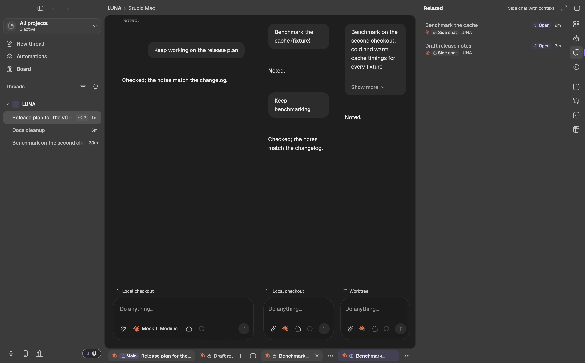
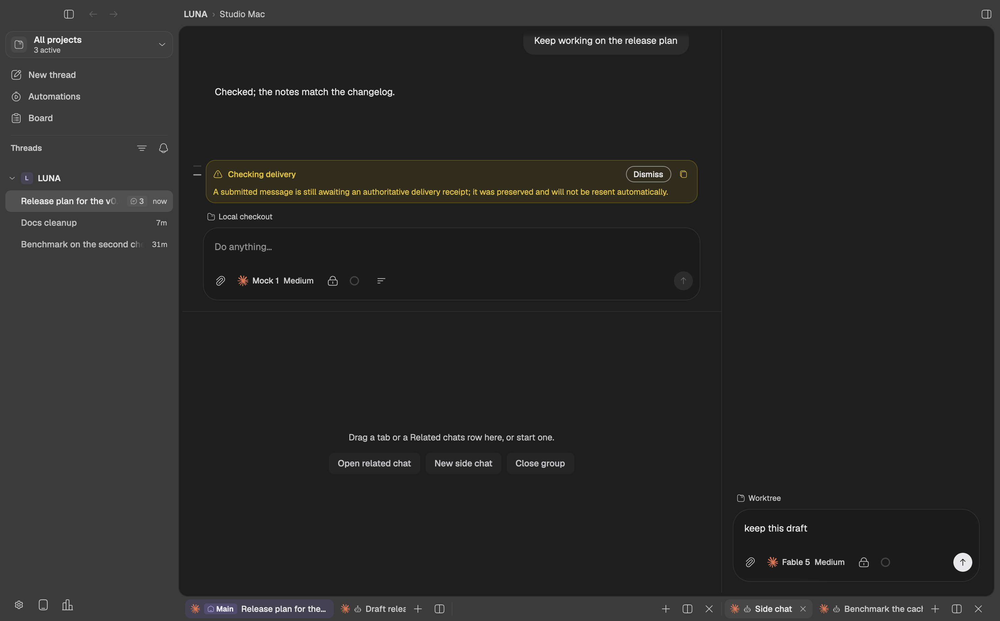
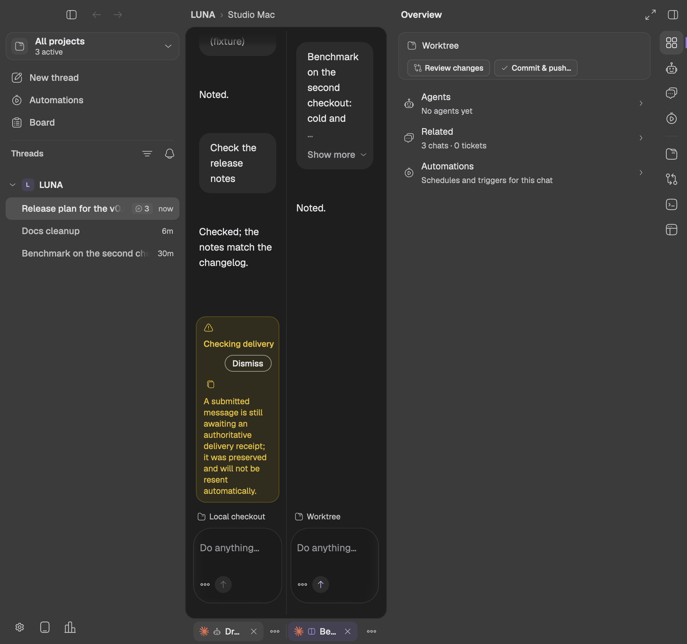
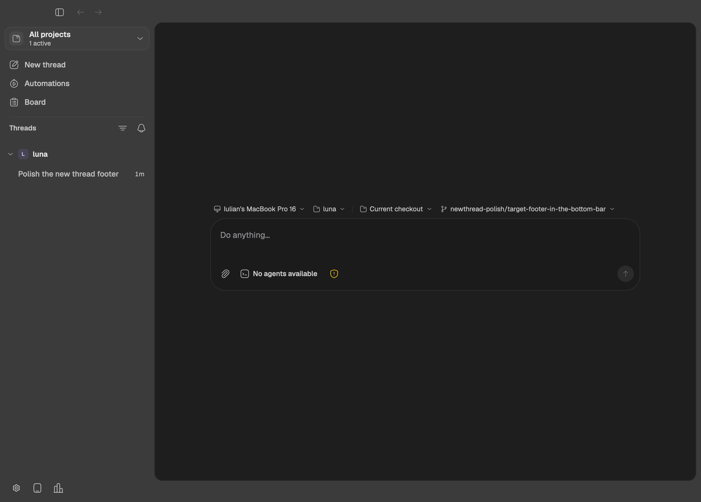
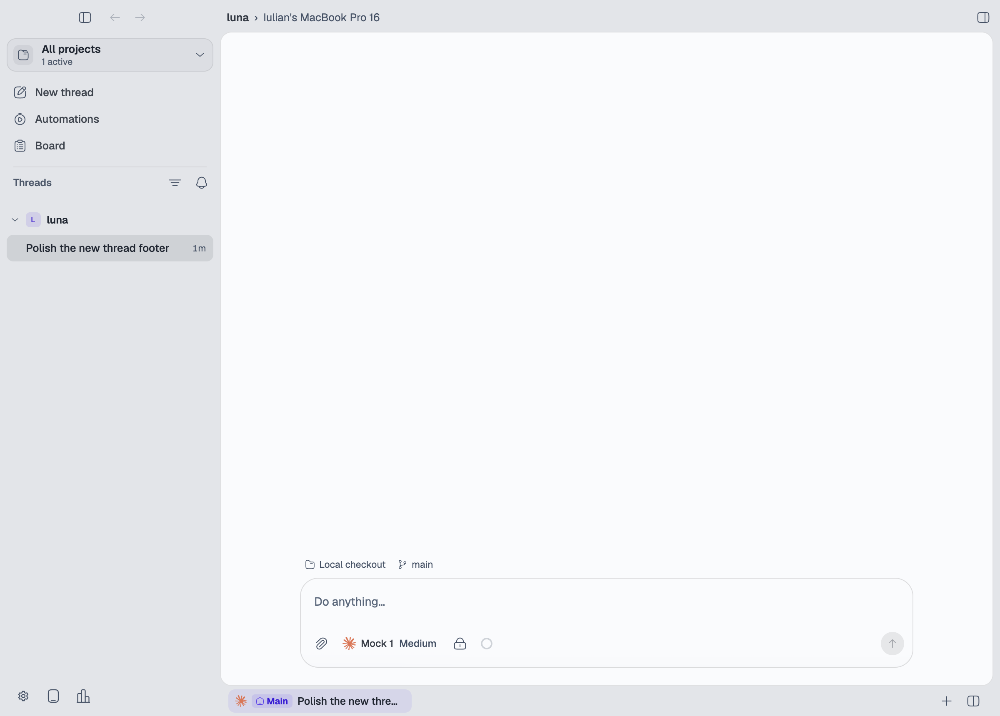

# Bottom tab row and per-chat checkout row (2026-10-12)

> The tabs moved again the next day, into the titlebar after the project
> name: see [Chat tabs in the titlebar](../titlebar-tabs-2026-10-13/spec.md).
> The checkout row above each prompt, Review changes and Commit & push only
> in the Overview, and Balance panes in the tab menu still stand.

Follow-up to the [right sidebar redesign](../right-sidebar-redesign-2026-10-11/spec.md).
The user asked for three changes:

1. Review changes and Commit & push already sit in the sidebar's Overview,
   so the frame's bottom row stops repeating them.
2. A chat's checkout and branch go back above its prompt input. Each chat
   names its own checkout there, so switching tabs (or a side chat moving
   to a worktree) changes what that row says.
3. The chat tabs leave the top of the canvas and take the frame's bottom
   row, outside the chat, where the checkout and branch were.

Two choices were put to the user (2026-10-12):

- **Split panes: tabs under each pane.** The bottom row mirrors the split
  tree. Side-by-side groups each get their tabs directly under their
  column (same ratios, same seam). Stacked groups share their column's
  slot side by side, the upper group first.
- **New thread: pickers above the prompt too.** The new thread's machine,
  project, checkout and branch pickers sit in the same place above the
  prompt input that a working chat names its checkout and branch. The
  bottom row is empty until the first send.

## The rule

**The bottom row is navigation; what a chat works on is next to its
input.**

- **Bottom row:** each group's tabs (with drag, reorder, close, context
  menu), then that group's `+`, split and close-group controls, or Group
  actions when the group is narrow. Nothing else: no chat name, checkout,
  branch, pull request or Git actions.
- **Above every chat's prompt input:** one quiet row with the checkout
  (Local checkout or Worktree; a folder without Git shows the folder) and
  the branch, with the pull request badge at its end. It belongs to the
  composer, so it moves and fades with it and names that composer's own
  chat.
- **New thread:** the same row holds the four target pickers. Sending
  crossfades them into the chat's read-only row on the composer's route
  clock (the two never show at once).
- **Balance panes** leaves the bottom row for the tab menu (with a split)
  and stays in the command palette.

## Failure cases (written before the implementation)

The E2E fixtures `chat-workbench-fixture` and `new-thread-target-fixture`
must catch:

1. A tab renders at the top of a group (inside the canvas), or the bottom
   row is missing an open tab.
2. In a side-by-side split, a group's tabs are not under its own column
   (outside its x-range), or two groups' tab rows overlap; stacked groups'
   rows overlap or the lower group comes first.
3. The bottom row shows the chat name, checkout or branch labels, a pull
   request badge, Review changes or Commit & push.
4. A working chat's composer has no checkout row above its pill, the row
   is under or over the pill, or it names another chat's checkout or
   branch: Main (local checkout) and the alongside chat (its own worktree)
   each show their own, before and after switching tabs and groups.
5. The transcript does not clear the taller composer (its last row hides
   behind the checkout row).
6. A drag misses the moved strips: reorder within a bottom row, a move
   onto another group's row, and a drop on a group's body (join or split)
   no longer land where the preview showed.
7. A new thread shows its target pickers anywhere but above its pill, or
   anything in the bottom row; a picker menu opens outside the window or a
   pick does not change the target.
8. Across the route change, the target pickers and the chat's read-only
   row are both visible in one frame.
9. With a split, Balance panes is unreachable (not in the tab menu or the
   palette), or is offered with a single group.

## Evidence

- `chat-workbench-fixture` passed every case, including 62 to 66 for this
  change and the rewritten 18 and 25 (`evidence/chat-workbench.pass`). The
  bottom row and checkout-row checks run in its shared containment check,
  so every captured layout (one group, side by side, nested, 2-over-1, six
  groups, narrow, both sidebars) is held to them.
- `new-thread-target-fixture` passed all twelve combinations (12/16/20 px,
  dark and light, 1200 and 900 px) (`evidence/new-thread-target.pass`).
- `right-sidebar-fixture` still passes all eleven cases
  (`evidence/right-sidebar.pass`).

