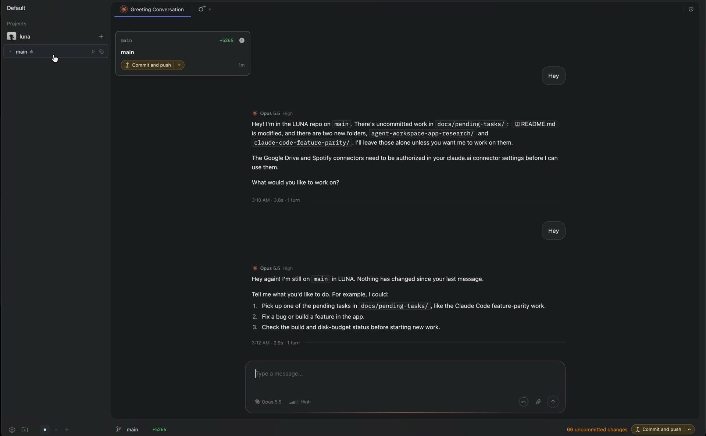
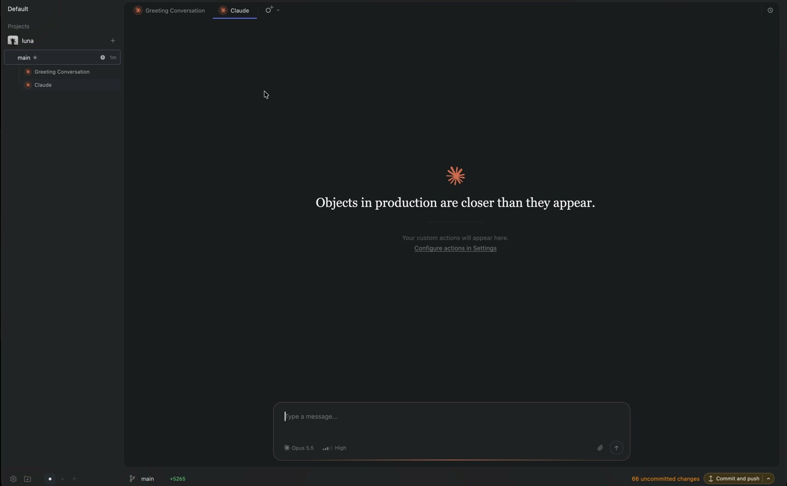
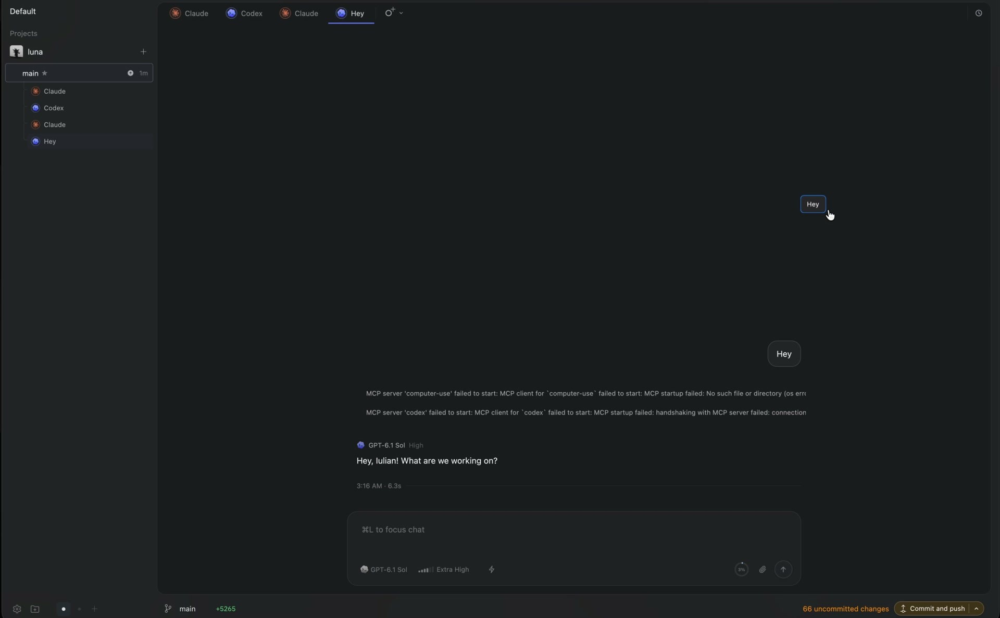
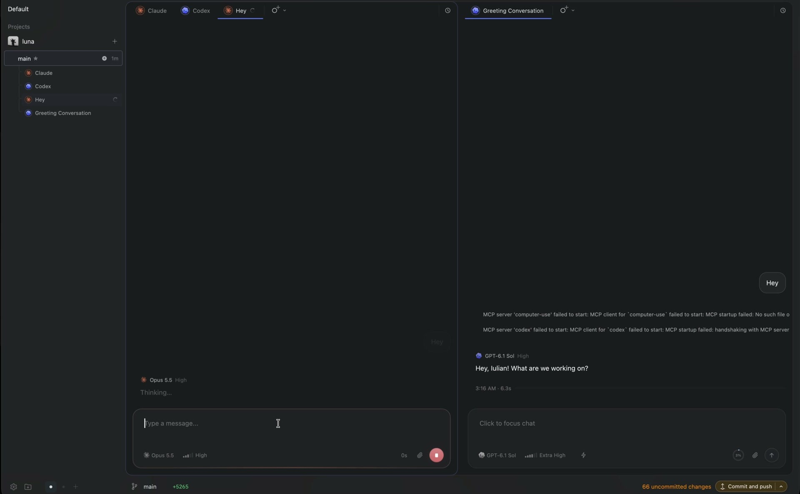
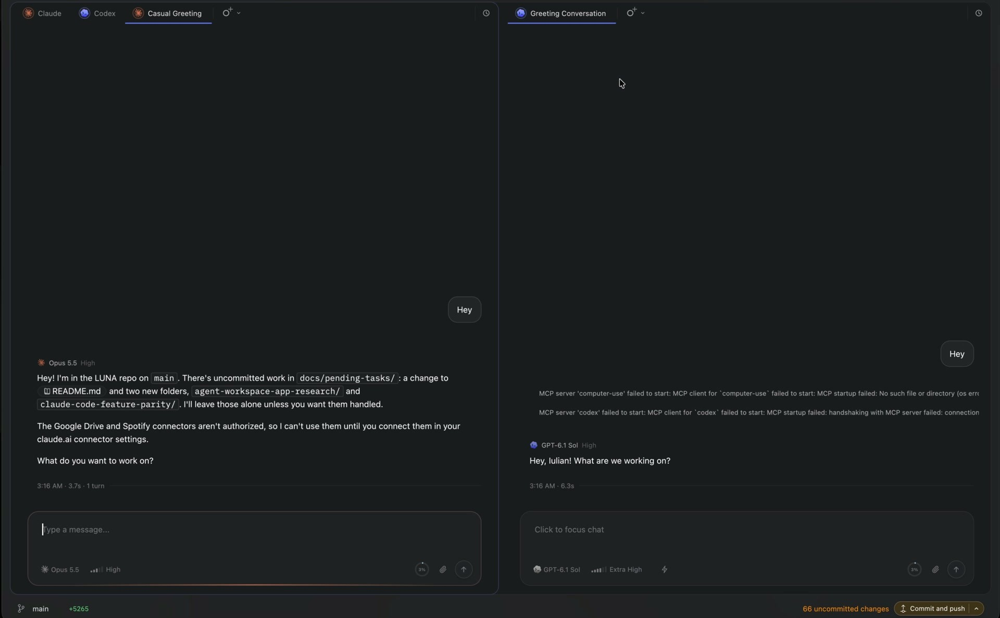
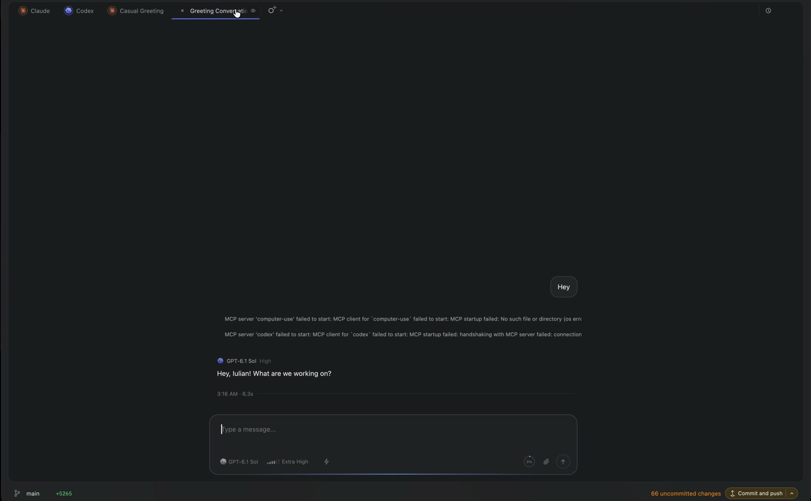
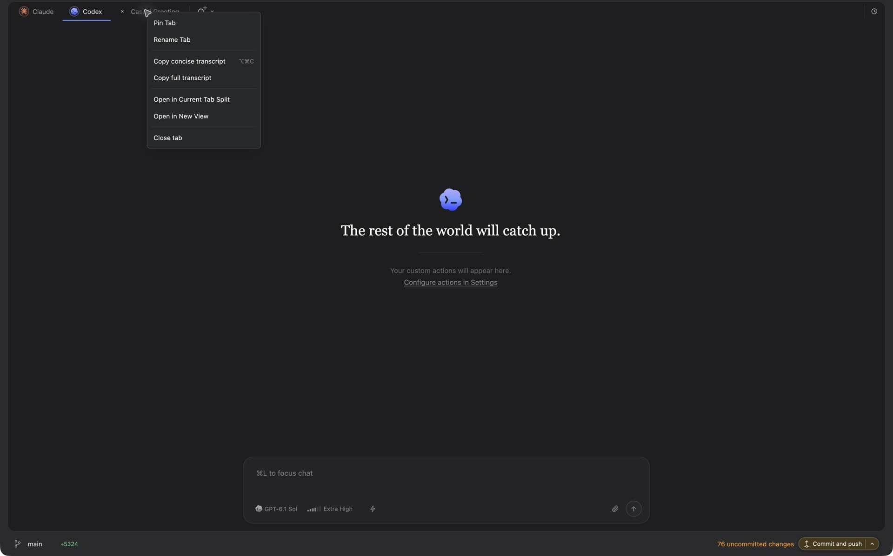

# Super interaction review

These are observations from Iulian's recordings and live native interaction,
not claims about Super's source code. The visible behavior guides LUNA's design;
LUNA's runtime and ownership rules remain authoritative.

## The visual composition to preserve

Recording 1, 00:15. The conversation sits in a darker, rounded inset with its
own tab strip. The surrounding app surface carries operational information.
The right sidebar is outside the reading canvas; the bottom-left branch and
bottom-right Git action belong to the frame. The transcript and composer share
a centered reading width. Sidebars can change the available width without
changing this hierarchy.

Recording 1, 00:32. The left navigation is another part of the frame, not another
conversation card. Copy the relationship between surfaces and the restrained
border treatment; keep LUNA's existing tools and sidebar vocabulary.

Recording 1, 00:39. A new tab has a stable identity and its own composer even
before a message exists. LUNA's equivalent is a genuine blank child, not a
hidden synthetic message or another copy of the main transcript.

## Tabs, split views and focus

Recording 2, 00:17. The drag follows the cursor as a compact labeled object.
The original chat must stay intact until the drop is accepted.

Recording 2, 00:18.5. A tab is now in another column, each column has a tab strip,
and the transcripts/composers are independent. The frame and sidebars stay put.

Recording 2, 00:23. Focus is legible in the pane outline and composer. A user
can direct one agent while watching another; changing focus must not retarget
a pending send or an approval.

Recording 2, 00:30. The split fills newly available width when the sidebar
collapses. The layout is proportional, with each composer fitting its pane.

Recording 2, 00:33. Returning a tab removes the unused split and expands the
remaining view. It does not produce a new conversation.

The [20-second interaction clip](evidence/10-drag-split-resize.mp4) covers
recording 2 from 00:15–00:35; original paths and exact source hashes are in
[the recording index](evidence/recording-index.json).

## Additional live inspection

Live inspection created a right-hand pane, then moved a third tab below the
left pane. It also moved pane headers back into the tab strip and restored the
original tab order. Super visibly supports both pane splitting within a view
and full view splitting. LUNA should expose one consistent tree of tab groups
for this feature; do not add a second overlapping layout vocabulary.

The context menu supplies explicit alternatives to drag gestures. LUNA should
likewise expose Open tab, Move to split, Close tab and Reopen closed tab through
visible controls and the command palette. The protected Main tab is a LUNA
requirement; it was not a behavior inferred from this menu.

Closing the existing Casual Greeting tab retained it in history. Reopening
initially selected terminal presentation and showed a permission-mode prompt;
no grant was accepted. Switching to Chat View restored the same transcript.
For LUNA, reopening must restore the existing chat view without changing
presentation type, permissions, provider identity or execution state.

Live automated divider drags did not produce a measurable resize, so no live
ratio-change claim is made. Split ratios and divider equalization are also
described in Super's [official layout documentation](https://super.engineering/docs/layout-sidebars-and-pip/).
Its [navigation documentation](https://super.engineering/docs/navigation-and-file-workflows/)
describes focusing an already-open conversation and restoring closed history.
The LUNA resize implementation still requires its own pointer E2E proof.

## LUNA adaptation

- One inset workbench, with Main permanently recognizable and protected.
- One tab per chat ID; main/child/side/alongside identity stays explicit.
- Edge preview means split, tab-strip insertion means reorder, pane center
  means join that group. Outside edges target the full workbench tree.
- Related chats remains the persistent collection. Open focuses or restores;
  dragging is an optional placement gesture, never the only way back.
- Close affects a view only. Stop, End, Archive and Delete remain explicit,
  separate operations with their existing ownership and permission rules.
- Motion communicates placement; it must not hide intermediate state or
  remount active agent/composer entities on every pointer move.
