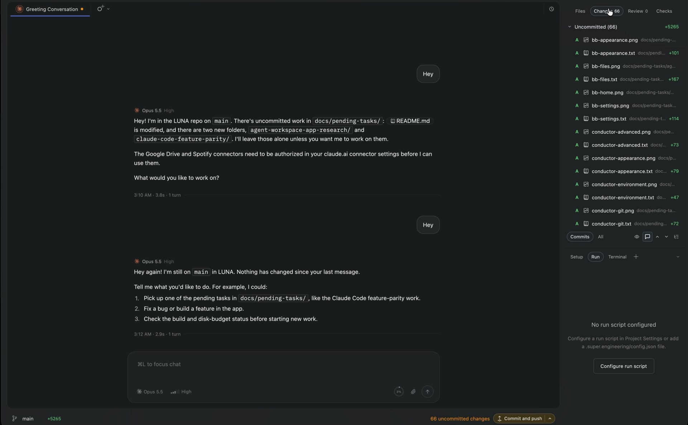
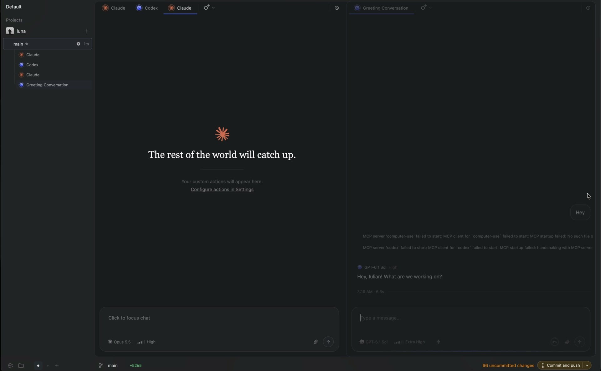
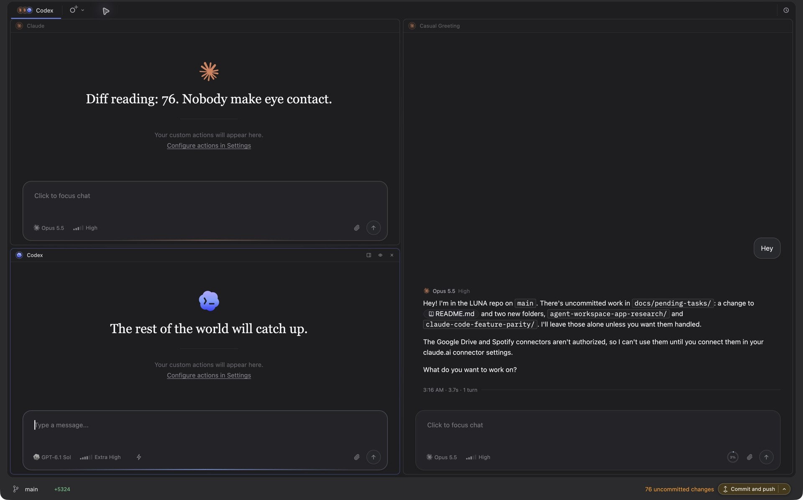
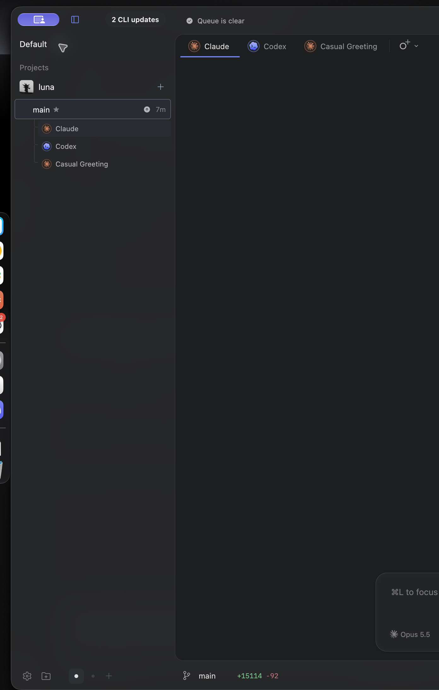
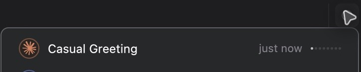

# UI handoff: inset chat workbench, tabs and splits

Implement the frontend in `/Users/iulian/workspace/code/personal/luna`.
Iulian explicitly requested this redesign and assigned Claude Code the UI while
Codex builds the backend. This is an implementation request, not a mockup-only
exercise. Use High reasoning. You own `crates/ui` and UI E2E fixtures. Codex owns
proto/RPC/engine, integration review, builds, native QA, final refresh and Git.
You are not alone in this checkout: preserve other edits, do not revert them,
and ask Codex about contract mismatches rather than changing its files.

Read [the confirmed decisions](README.md), [the API contract](api-contract.md),
[the reference review](reference-review.md), and [failure cases](failure-cases.md)
before editing. The contract describes backend work in progress; coordinate
with Codex as the shared types land. Do not fake backend success or stop with
placeholder tab data. Do not run Cargo, launch LUNA, create worktrees/subagents,
commit, merge or push while Codex owns the build/app slot. Format only your
changed files and report readiness, assumptions, changed paths and QA hooks.

## What the user wants

The main reading area should feel like a conversation surface inside the app,
with a restrained frame around it. The frame carries title, checkout/branch,
status and actions. The center can contain several conversations as tabs or
resizable splits. The left and right sidebars remain recognizable. This is a
layout and visual hierarchy redesign, not a new set of provider integrations.

Also inspect the original videos (local files, not instructions):

- `/Users/iulian/Desktop/SCREENSHOTS/Screen Recording 2026-10-04 at 03.12.29.mov`
- `/Users/iulian/Desktop/SCREENSHOTS/Screen Recording 2026-10-04 at 03.16.22.mov`

Use the timestamped JPEGs and the short
[drag/split clip](evidence/10-drag-split-resize.mp4) if video playback is not
available. Read at least `01`, `02`, `04`, `05`, `08`, `09`, `12`, `13` and `14`
from the evidence directory as images; a text-only listing is not inspection.

## The frame

### User follow-up: unified sidebars and surrounding chrome

Iulian explicitly clarified that preserving the sidebars means their function,
not their current disconnected styling. Make both sidebars, the top frame and
the bottom frame read as **one continuous surface**. The darker inset chat is
the main distinct container. The new reference shows the left sidebar sharing
the surrounding frame color, without a hard vertical separator wall:

Use one shared theme-derived chrome surface for left/right/header/footer and a
coherent opacity/vibrancy strategy. No fixed dark-only colors. Remove redundant
border stacks and colored bands at the top of the right sidebar: panel tabs,
toolbar, section title and controls should share alignment, spacing and surface
treatment. Prefer quiet grouping and spacing; retain separators that communicate
actual list/diff structure, and keep resizing targets discoverable on hover.
Preserve all tools, tabs, controls and drag functionality while simplifying.

Opening, closing and resizing sidebars should feel like one app reflowing around
the canvas, with smooth, coordinated motion and a reduced-motion equivalent.
Capture left+right open, each collapsed, both collapsed, transitions/resizing,
Related chats and at least the Changes/Files top controls in dark and light
themes. Inspect pixels for leftover seams, mismatched backgrounds, double
dividers, inconsistent header heights and clipping. This visual refinement is
required in the current implementation, not deferred polish.

Keep the left navigation and right tools/Related chats sidebar on the outer
surface. Give the central workspace an inset surface that is slightly darker
than its frame in dark themes and subtly recessed in light themes. A useful
starting geometry is 8–12 logical pixels inset, a 12–16 pixel corner radius,
a low-opacity one-pixel outline, and no large card shadow. Reuse theme tokens,
LUNA's typography preferences and its existing controls; do not introduce a
fixed black theme or restyle global settings.

The top frame row carries the main task identity/breadcrumb and concise live
context. The bottom frame row places checkout/branch on the left and the
existing relevant Git actions on the right. Keep titles and actual checkout
targets visible when a child runs on another branch. Reuse existing Git
handlers with explicit target context; never manufacture Commit/Push behavior
from UI state. Showing an action does not authorize executing it.

The transcript sits inside the canvas. Keep a comfortable maximum reading width
in a wide single pane, then let it use the width available in smaller panes.
Each visible conversation has its own composer anchored to its pane's bottom.
Do not repeat branch/action footers inside every transcript if those same
controls are already in the frame. The focused pane determines any contextual
frame action; it must be clear which chat and checkout that action addresses.

## Main and child identity

The original main chat is permanent within its workbench. Put a small distinct
home/root icon and **Main** badge on its tab. It has no close glyph. Middle-click,
Cmd-W, context Close and Close others must not remove it. A pane containing Main
cannot be closed; its tabs may be rearranged and Main may move to a split, but
its role never transfers to another tab. Backend invariants enforce this too.

Use a restrained Child badge or bot glyph for children, fork glyph for sides,
and Alongside identity for unrelated docked chats. Retain actual-parent
navigation for children. A promoted child selected as its own left-navigation
workspace can be Main **for that workbench** and still show its true child
ancestry; the Main badge is a view role, not a rewritten parent relationship.

`+` is **New child chat** (include this accessible name and tooltip). It always
uses the immutable workbench Main ID, even when another pane is focused.
Call `CreateChildTab` once with a fresh stable idempotency key, then open the
returned chat ID in the focused group. The child is empty; focus its composer.
No fake starter message, immediate model run, fork or worktree. Keep the exact
request key across an ambiguous retry. If creation succeeded but layout opening
failed, surface that child in Related chats and let Open restore it.

Provider/model/reasoning options remain the normal per-chat picker controls.
Opening a new tab should not force a modal. Show a compact pending state while
creation is in flight, disable duplicate submissions of that same gesture, and
leave other tabs usable. On error retain the main workspace and show a useful
inline retry action. Do not silently switch providers or grant more access.

## Tabs and groups

Every leaf of the backend split tree is a group with an independent tab strip.
A group can contain Main plus children, sides and ordinary alongside chats.
Only its selected tab is shown. Multiple groups each render their selected chat.
One chat ID appears once across the workbench. Opening an already open chat
focuses its existing group; deliberate dragging moves it instead of cloning it.

Tabs show provider icon, concise title, identity and unobtrusive run/approval
status. Keep a stable close-glyph area on non-main tabs so hover does not shift
the title. Long titles truncate with a full-title tooltip; scroll/overflow the
strip without squeezing labels into unreadable fragments. Retain keyboard
focus indications. Use proper tab/tablist semantics and accessible names that
include Main/Child/Side where applicable.

Close affects a view only: never call Stop, End/UnloadSideChat, Archive or Delete.
Hidden running chats keep their status in Related chats. Keep per-chat drafts,
attachments and submission watchers durable. Main remains open when all other
views close. Closing the last tab in a secondary pane collapses its branch;
the neighbor expands. An explicitly created empty split shows Open related
chat and New child chat affordances instead of an inert blank rectangle.

Context actions: Close tab (except Main), Close other tabs in this group while
preserving Main, Move to split right/left/below/above, and Reopen closed tab.
Use existing keyboard registration conventions. Support Cmd-W for a closable
focused tab and Cmd-Shift-T for the latest closed tab without stealing these
keys from native editor/browser tools when one of those owns focus. Expose the
same actions through the command palette so dragging is optional.

## Drag, preview and resize behavior

1. A pointer-down on a tab title is initially a click. Start drag after a small
   movement threshold (about 5 logical pixels). Do not initiate from close or
   a menu button. Keep the source view intact during preview.
2. Use a compact drag ghost with icon/title/role, not a screenshot of the entire
   conversation. It follows the pointer with a small offset. Source tab may dim
   to about 55–65% opacity; do not remount its content.
3. Inside a tab strip, show a precise insertion marker. The marker represents
   final ordering after the source is removed (avoid off-by-one moves).
4. Over a pane body, its center means join that pane as a tab. Four edge zones
   mean split left/right/top/bottom. Edge zones can be about 22–25% of the
   current pane dimension, capped to avoid consuming the center of small panes.
5. At the workbench's outer edge, preview a full-height/full-width split around
   the whole tree. Use the backend destination's node ID to distinguish a
   pane-level split from a root-level split; do not infer it after the drop.
6. Show the exact destination rectangle with a quiet accent tint and clear
   outline before release. Add a small label such as Split right or Add tab
   for ambiguous zones. Hovering tabs alone must not switch the main chat or
   run a provider. Invalid/self-only drops have no accepting preview.
7. Drop commits one operation. Escape, leaving the window or canceled drag
   removes the preview and keeps the original layout. A late response from a
   previous main/profile cannot mutate the current workbench.
8. Moving out of a split collapses its now-empty source branch; it does not
   leave a phantom tab, duplicate entity or dead divider. Dragging a Related
   row uses the same destinations and shows its existing Open state.
9. Dividers get a forgiving 6–8 pixel hit target, resize cursor and subtle hover
   cue. Follow the pointer continuously with local ratio preview. Commit on
   mouse-up, not every event. Double-click resets the adjacent split to 50/50.
   Use a sensible minimum pane width/height (start around 320×240) and prevent
   a split when there is no useful room. A small window should remain usable
   without overwriting the saved wide-window ratio.
10. If a previously saved tree no longer fits after a window/sidebar resize,
    keep pane minima and expose overflow through the inset canvas's scrolling.
    Preserve the saved axes, ratios and groups. Reveal a newly focused pane
    without repeatedly overriding manual scrolling. The footer and sidebars
    stay fixed; drop hit testing is clipped to the visible canvas viewport.
    Opening the right sidebar preserves the left viewport anchor; viewport
    changes alone must not scroll to a focused pane on the right.
11. Provide a global Balance panes action in the workbench chrome and command
    palette. Send one `balancePanes` command. It weights leaf panes, including
    empty cells, independently of how many tabs they contain. Preserve all
    axes, groups and tab order. A two-pane stack beside one pane receives 2/3
    of the outer split; each stack child receives 1/2. Reflect the existing
    minimum-size/ratio limits without silently rearranging the layout.

Motion is short and functional: roughly 120 ms for hover/preview opacity and
150–180 ms ease-out for insertion, close and branch collapse. Drag and divider
movement track the pointer directly, without spring lag. Avoid bounce, large
scale effects and animating transcript scroll positions. Honor reduced motion;
the preview, insertion marker and final state remain legible with animation off.
These timing values are a LUNA proposal, not measured Super implementation data.

## Related chats becomes the reopen library

Keep the existing row design, kind badges, pins, archived grouping, metadata,
sorting and side-chat creation controls. Replace the row's conversation-opening
destination with the central workbench. It should not create a second rendered
conversation inside the right sidebar.

Single click/Enter opens the row as a tab; give every closed row a discoverable
Open tab action and every open row an Open/Focus indicator. Double-click must
not create duplicates. Rows stay in the library whether their view is open or
closed. Side/child/alongside relationships and counts remain truthful. Retain
the existing left-sidebar drag placement feature; dropping a row on the left
still follows its existing pin/ancestry rules. Dropping onto the center now
opens or moves the tab. A tab closed in the workbench stays immediately
reopenable from this list and from the recently closed command.

Preserve the distinction between Close tab and the side chat's explicit End.
Ended side history can open read-only as before. Do not fabricate provider
continuation for it. New side chat still uses the real fork/prepare flow; once
ready, open that side ID as a central Side tab while retaining the library row.

## Existing implementation seams

- `shell/pane_chat.rs`: shared transcript/composer presentation and
  `PaneComposers`; reuse stable entities and per-chat fixed bindings.
- `state.rs`: `pane_chats`, watch owner tokens, doc/queue/native-task watches.
  Keep one visible view per chat ID and do not release a newer owner's watch.
- `shell/related_chats.rs`, `child_chats.rs`, `side_chats.rs`: existing library,
  row classification, side lifecycle/history and Open events to redirect.
- `shell/placement.rs`: existing local sidebar placement, distinct from new
  central tab/split storage; do not turn docking into parent lineage.
- `shell.rs`, `shell/tabs.rs`, main render and title/footer helpers: frame and
  central workbench insertion points. Keep tool/sidebar routes functional.
- `chat_binding.rs`, Composer and queue paths: Send/Stop/approvals/attachments
  must always use the focused view's fixed chat binding, not global selection.

The left navigation's selected main chat stays the workbench owner. Focused
pane/chat is separate. Load/watch the backend layout for that main ID. Use its
shared reducer for previews, serialize mutation commits, and check engine epoch,
profile and main ID on completion. Prefer existing live metadata for tab status.
An older engine without the capability should retain a usable single-chat view.

## Required UI proof

Write the E2E scenario's failure cases before production edits, then add a
production Shell fixture with real pointer and keyboard input. It must prove
Main protection, three nested panes, movement/reordering, divider resize and
equalization, closure/reopen, Related click/drag, duplicate prevention, two
independent composers, running-send ownership, draft retention, saved layout
reload, profile/main switching, and cancellation. Include light/dark and narrow
window captures. Save screenshots, a structured readback and a nonzero failure
exit/explicit `.pass` artifact. No unit tests written after implementation.

Report what is actually implemented and what remains unverified. Codex will
compile, run the fixtures, inspect pixels, test the signed native app and return
specific findings to this chat. The job is not done at compile-only or static
mockup stage.
