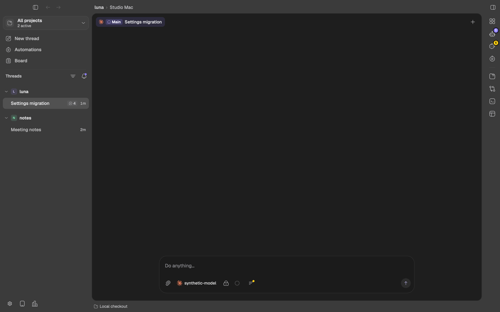
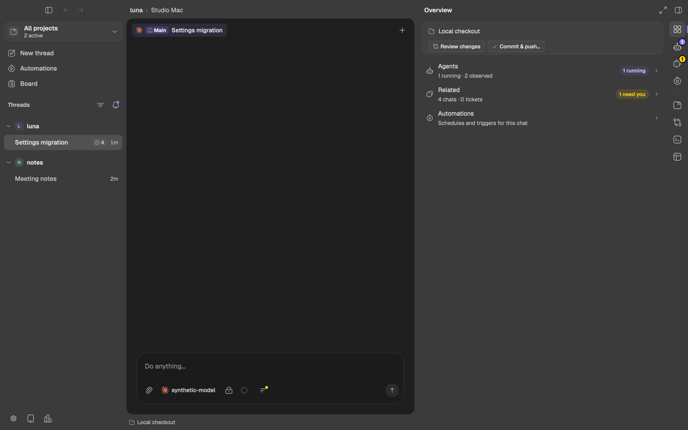
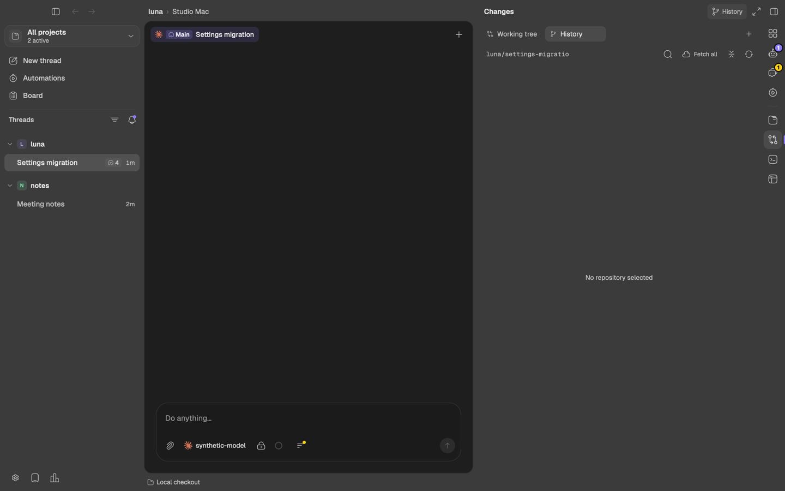

# Right sidebar redesign (2026-10-11)

The user reviewed four layouts ([options page](https://claude.ai/artifact/HZJN92fN3zLWXxgkbF1n1t))
and chose **Option B: the icon rail**. (They first picked A by mistake; A
was replaced before landing.) The research behind the options (BB
`3912f4aa`, T3 Code `9ec472c7`) is on the same page.

## The rule

**Every place has a fixed spot, and nothing navigates back.**

- A thin **rail** (44 pt) sits at the window's right edge whenever a chat is
  selected: the chat's own places (**Overview, Agents, Related,
  Automations**) above a line, workspace tools (**Files, Changes, Terminal,
  Browser**) below it.
- Clicking a place opens the sidebar there; clicking the active place closes
  it. The rail stays when the sidebar is closed, with its **badges**: running
  subagents on Agents, related chats that need you on Related, a dot on
  Terminal while terminals are open.
- A workspace place lists its open instances in **its own tab row** (close,
  drag, middle-click, right-click menu with Close others / Close to the
  right). `+` opens another terminal, page or diff; Changes' header opens
  History. Returning to a place shows the tab it last showed.
- A workspace place with nothing open opens its first instance on the rail
  click (Files browses, Changes diffs the working tree, Terminal restores the
  chat's saved terminals or starts a shell, Browser opens a page). Closing a
  place's last tab leaves that place's empty state, which says why (for
  example "No Git repository in this folder.") and offers to open one.
- **Conversations open in the canvas.** A side, child or alongside chat
  opens as a workbench tab (or as the main chat when the workbench is
  unavailable). The sidebar never renders a conversation.

## What replaced what

| Before | After |
| --- | --- |
| Titlebar strip of every surface tab | The rail, plus each place's own tab row |
| "Open in this pane" picker, `+` menu, "Back to panels" | The rail |
| Agents tab | Agents place (subagent transcripts as its tabs, "All agents" pinned) |
| Related tab (chats and tickets) | Related place; "Side chat" in its header |
| Automations tab | Automations place |
| Diffs and History menu rows | Changes place: diff and History tabs |
| Child chat drilled into the Related pane, with Back | Opens in the canvas, or as the main chat |
| Sidebar toggle only | Toggle (kept, above the rail) and the rail |

Anything that used to open the Agents, Related or Automations tab now opens
that place.

## Overview

Status (the checkout's branch or kind, its pull request, Review changes and
Commit & push…) and one row per chat place with its live summary (agents
running, related chats and tickets, needs-you). A row opens its place; the
rail follows.

## Failure cases (written before the implementation)

The E2E fixture `crates/ui/examples/right-sidebar-fixture.rs` must catch:

1. Opening the sidebar on a chat shows anything other than the Overview
   place, or the rail is missing.
2. The rail misses a place or orders them wrongly, or is not at the window's
   right edge with the sidebar ending where it starts.
3. Clicking a place does not open it; clicking the active place does not
   close the sidebar; the rail disappears with the sidebar closed.
4. With the sidebar closed, a running subagent does not badge Agents or a
   related chat waiting for approval does not badge Related.
5. A Back state exists: a state visited is neither a place's own page nor a
   tab of the place the rail shows.
6. Changes does not open a working-tree diff on its first visit with Git,
   History does not open as another Changes tab, returning to Changes does
   not show its last tab, or without Git the reason is missing.
7. A place's tab row lists another place's tabs.
8. Closing a place's last tab leaves anything but that place's empty state
   with a way to open one.
9. A former entry point (the related count, Agents, Automations) opens
   anything but its place, or creates a tab for it.
10. Clicking a related chat renders that conversation inside the sidebar.
11. An Overview row does not open its place.

## Evidence

`right-sidebar-fixture` passed all eleven cases (`evidence/right-sidebar.pass`, `evidence/readback.json`):

