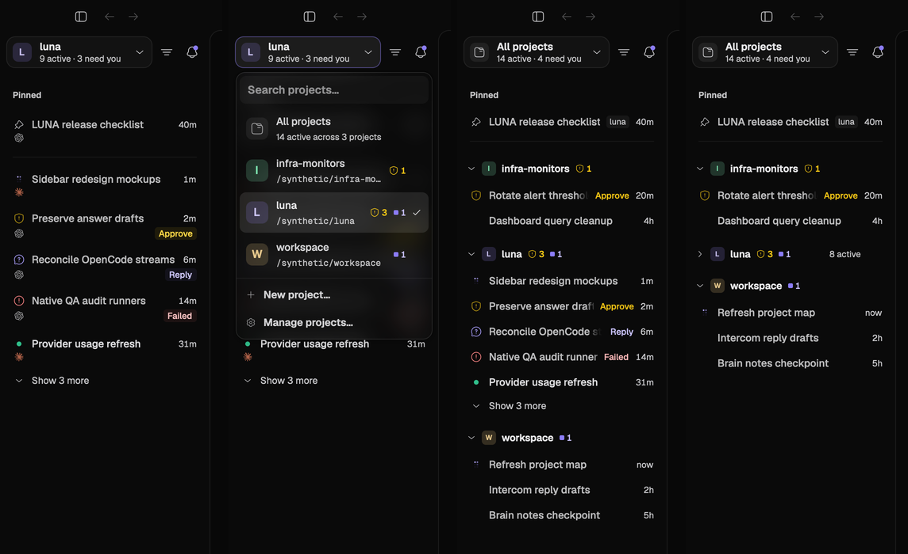

# Sidebar redesign (2026-10-08)

The user reviewed four sidebar concepts and chose a combination: **Design A**
when one project is selected and **Design D** when the sidebar shows All
projects. The existing square glyph loader stays as the Working indicator.



## Project pill and picker (both views)

- The project trigger is a bordered pill: the project's tile (its monogram on
  its tint), its name, and a live summary (`9 active · 3 need you`). All
  projects shows a neutral folder tile and the totals of every project.
- Project tints come from six well-separated hues, taken in the order the
  projects were added, so the first six never share one and a new project
  never recolours the others (`shell/sidebar_projects.rs`).
- Each picker row shows the tile, name, folder path (home as `~`) and live
  counts: needs-you (shield) and working (small square), or the last activity
  time when the project is quiet. The current project keeps its check. The
  pinned footer holds New project… and Manage projects… (Settings ›
  Projects); both stay in the keyboard order.

## Single project (Design A)

- Two-line rows. The status leads the title: the square loader while
  Working, a shield for an approval, a question bubble for input, a danger
  circle for a failure, a dot for Done, the pin for an idle pin.
- The harness mark moves to the start of the meta line, beside the branch
  and note. A task waiting on the user ends the meta line with a pill naming
  the next step (Approve, Reply, Failed, Queued), cut to the PR badge's cloth.
- Sections, Show more, the device grouping option and the Settled/Archived
  shelves are unchanged.

## All projects (Design D)

- Pinned stays first; each pin names its project. Every other task lists
  under its project's collapsible header, projects in the picker's
  alphabetical order so a busy project never pushes the others around.
- A project header shows the chevron, tile, name, needs-you and working
  counts for that group (pins excluded, rows behind Show more included), the
  active count while folded, and a New task button under the pointer.
- Rows are compact (one line, 32 pt at the default Interface size): status,
  title, the needs-you word without a pill, the host machine when it is not
  this one, and the time. Each project pages its own five rows, folds on its
  own (`project:{id}` keys) and reorders only among itself.
- The Settled and Archived shelves stay at the bottom of the list.

## Verification

`crates/ui/examples/sidebar-redesign-fixture.rs` drives the production Shell
headlessly with real pointer and keyboard input at Interface sizes 12, 16 and
20. Its header lists the ten failure cases written before the implementation.

```bash
scripts/cargo.sh build --locked -p luna-ui --features appshots-fixture --example sidebar-redesign-fixture
target/debug/examples/sidebar-redesign-fixture "$PWD/target/qa-evidence/sidebar-redesign"
```

The 2026-10-08 run passed, together with `sidebar-polish-fixture` and
`sidebar-sections-fixture`. Its PNGs, `readback.json` files and `SHA256SUMS`
are preserved locally under `target/qa-evidence/sidebar-redesign-2026-10-08/`.

Follow-ups not in this change: listing each project's own Settled and
Archived rows inside its group (Design D's shelf board), and showing quiet
projects (no active tasks) as folded headers.
