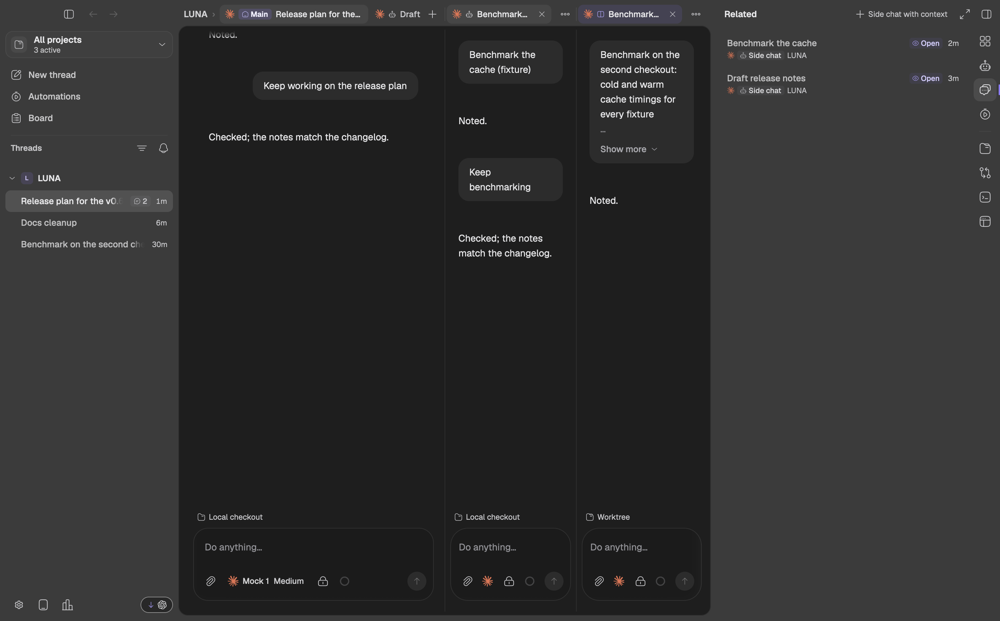
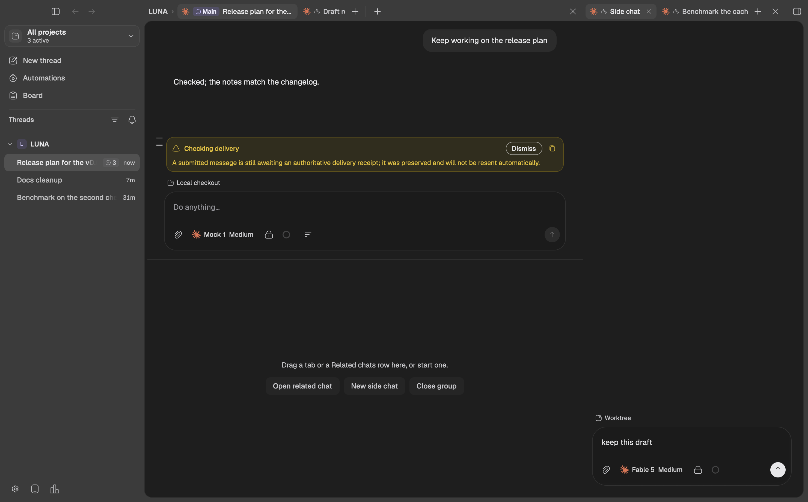
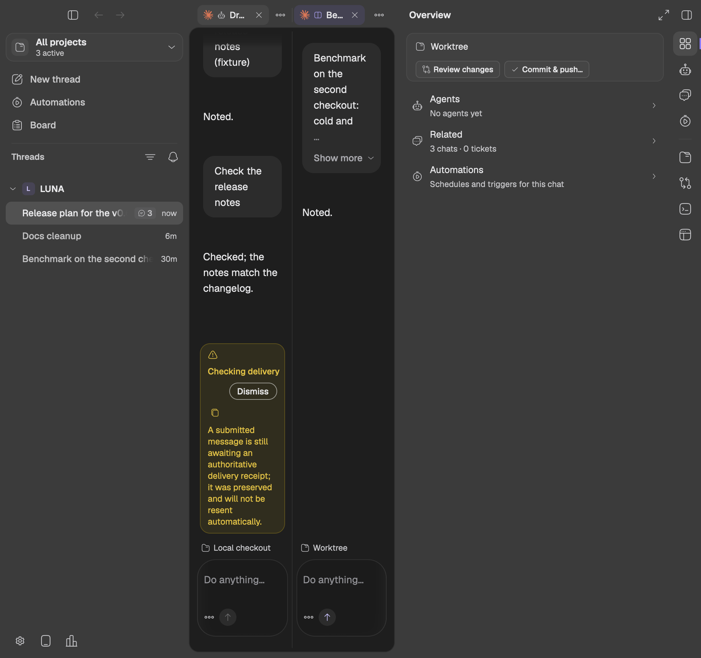
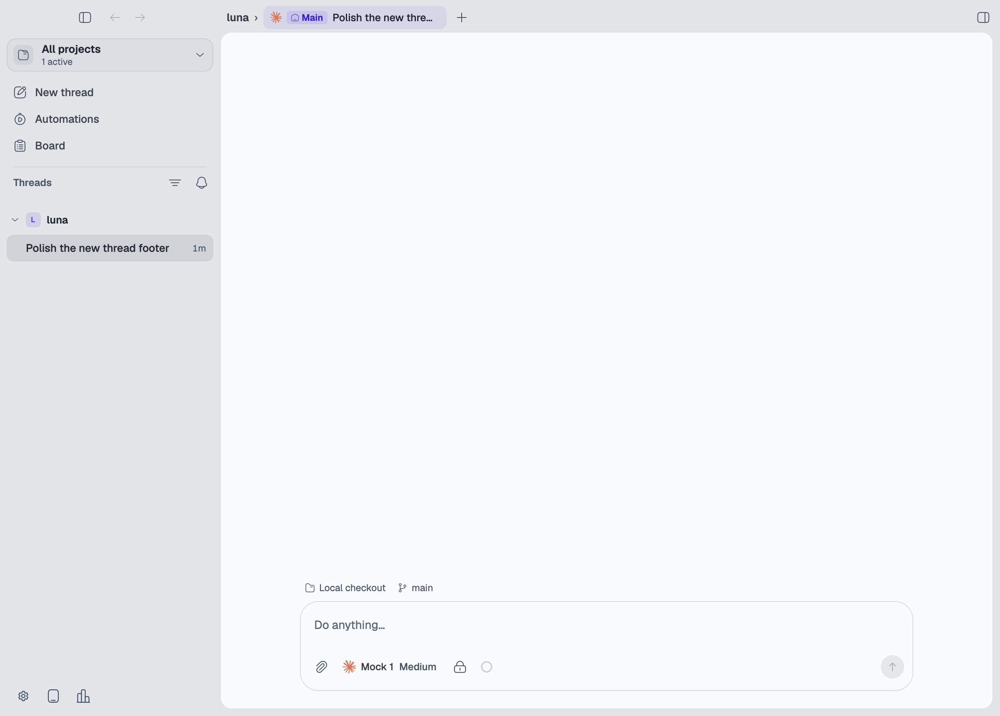
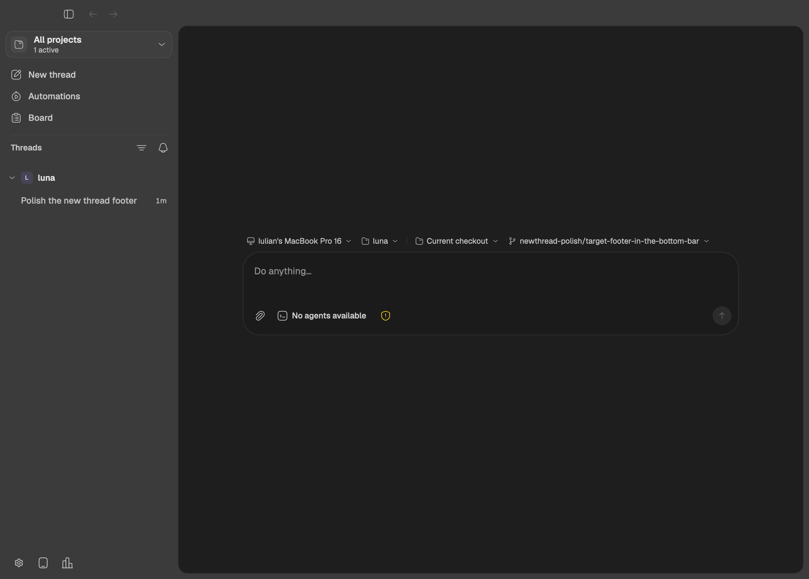

# Chat tabs in the titlebar (2026-10-13)

Follow-up to [the bottom tab row](../bottom-tabs-2026-10-12/spec.md). After
living with it, the user asked for the tabs to move into the titlebar:

- The titlebar read "luna › Iulian's MacBook Pro 16", project then device,
  which was confusing. It now reads project, then the chats: "luna ›
  Main · Side chat · +".
- A new side chat appears there next to Main, as the bottom row showed it.
- `+` sits right after the last tab, so it moves right as chats are added.
- The split button goes: dragging a tab to a side splits.
- The bottom row goes, and the chat canvas reaches the window's bottom
  inset again.

What stays from the bottom-row design: each chat's checkout row above its
prompt, Review changes and Commit & push only in the Overview, Balance panes
in the tab menu, and a split's tabs laid out over their own columns (now
above them). The device leaves the titlebar; a chat that runs on another
machine names it at the start of its checkout row.

## Failure cases (written before the implementation)

`chat-workbench-fixture` and `new-thread-target-fixture` must catch:

1. A tab paints anywhere but the titlebar band (inside the canvas or in a
   bottom row), a group has no strip there, or the canvas does not reach
   the window's bottom inset.
2. The titlebar still names the device, or the project name is missing
   ahead of the first group's tabs.
3. `+` is not right after its group's last tab (it sits at the strip's far
   end, or before a tab), or a strip still offers the split button.
4. A side-by-side group's strip is not over its own column, two strips
   overlap, a stacked split's upper group does not come first, or a strip
   runs under the window-control cluster or the right sidebar toggle.
5. A drop on a strip in the titlebar does not reorder or move the tab.
6. A focused tab in the titlebar no longer belongs to its group (Cmd-W,
   composer keys, Tab and Shift-Tab between groups).
7. A chat on another machine has no device in its checkout row, or a chat
   on this machine shows one.
8. A new thread shows any tab strip.

Pressing or dragging a tab must not move the window, while dragging the
titlebar's empty space still does. Window moves are native, so this is a
LUNA Dev check, not a fixture case.

## Evidence

- `chat-workbench-fixture` passed every case, including 62 to 67 (the tab
  row in the titlebar, strips over their columns, `+` after the last tab,
  drops on a strip, Balance panes from the tab menu) and the rewritten 18
  and 25 (`evidence/chat-workbench.pass`). It ran with
  `RUST_MIN_STACK=16777216`: on current `main` the in-process engine's
  tokio worker overflows its default stack late in the run (after w20l),
  in engine code this change does not touch.
- `new-thread-target-fixture` passed all twelve combinations, including
  the new case 11 (a chat on another machine names it first in its
  checkout row) (`evidence/new-thread-target.pass`).
- `right-sidebar-fixture` passed all eleven cases
  (`evidence/right-sidebar.pass`).

Issues found and fixed while building it:

- A tab was capped to its tab list's measured width, but that list now
  hugs its tabs, so the cap shrank every frame (the clipped Main tab). Tabs
  are now capped by the strip's room for tabs and `+`.
- Tabs and strip buttons block the titlebar's window drag, which also hid
  the row's drop listeners; each takes drops itself. Tabs use
  `block_mouse_except_scroll`, so the wheel still scrolls a crowded strip.
- In a narrow first strip the project name gives its room to the tabs.

