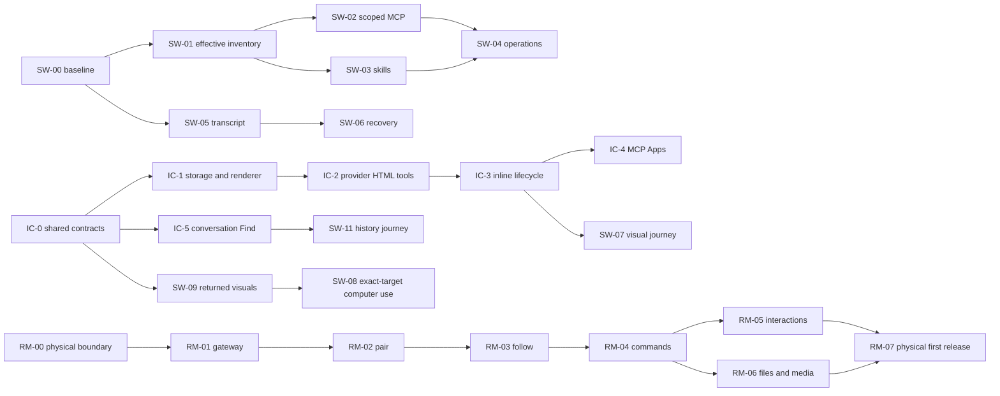

# How the pending work fits together

Inventory date: **11 October 2026**. Original source cut:
`c72a444a3cc9a4e7a91785c5b34d7b947b7ffec9`; the added core/SDK/plugin audit uses
`2838125e42646b5d5ba86a3f8dfbdd93922ec60d`. This is a scheduling and ownership
audit of the pending specifications, supplemented by targeted current-source
checks. It does not certify future runtime behavior or repeat every historical
live acceptance run.

There are **90 catalog entries**: **59 Ready**, **1 Blocked**, **25 Deferred**,
and **5 shipped Board references**. Active acceptance coverage starts at 0%
for the 60 active-scope tasks. Source research and mockups do not count as
implementation acceptance. Later status is maintained by the CLI and its
dated [checkpoint](progress.md), rather than these initial counts.

## Workstreams and source ownership

| Group | Canonical queue tickets | Detailed specification ownership |
| --- | --- | --- |
| `core-platform` | CORE-00–CORE-23 | [Extensible core](extensible-core/README.md): public contracts/SDK, supervised plugin runtime, dynamic providers/UI/content, feature extraction and measured migration gates. |
| `integration` | SW-00–SW-03 | [LUNA-only workflows](luna-only-workflows/README.md): actual capability, effective tool/skill inventory and scoped provider delivery. |
| `transcript` | SW-05, SW-06, ZI-03; deferred AW-08 | LUNA-only owns ordinary chronology/recovery certification; [Zeron improvements](zeron-upstream-improvements/README.md) owns current checklist wire/fold/presentation; workspace research owns optional preferences. |
| `artifacts` | IC-0–IC-4, IC-6, SW-07, SW-09; deferred SW-14, AW-12 | [Interactive surfaces](interactive-chat-surfaces/README.md) owns HTML storage/isolation/provider tools/MCP Apps; LUNA-only adds returned media and real user journeys; research adds only optional annotation. |
| `navigation` | IC-5, SW-11, ZI-04, ZI-05; deferred AW-01 | Interactive surfaces owns conversation Find; Zeron owns typed file activation and workspace text search; LUNA-only consumes Find/import/global history; research owns settings destinations. |
| `workspace` | ZI-01, ZI-02; deferred AW-02/04/05/06/07/09/11/15 | Zeron owns concrete Git snapshot/registry growth defects. [Workspace research](agent-workspace-app-research/README.md) owns audit-first context, commands, routes, layouts, Git guidance, diagnostics, portable config and companion ideas. |
| `orchestration` | SW-10, SW-12; deferred AW-03/10, PB-4A–PB-4D; PB-0/1/1R/2/3 references | [Board](devin-project-board/README.md) owns shipped ticket/chat/review identity; LUNA-only adds supervision/certification. One future owner handles groups/templates/trackers/workflow expansion. |
| `remote` | RM-00–RM-07; deferred RM-08–RM-13, SW-16 | [Control this Mac](control-this-mac/README.md) owns architecture and M0–M4. [T3 audit](t3-remote-mobile/README.md) adds RM requirements, lane reports, gap matrix and expanded physical acceptance. |
| `operations` | SW-04, SW-08, SW-13 | LUNA-only owns evidence-to-draft, exact-target computer use and actual local recurrence journeys. |
| `release` | SW-15, UP-01 | Switching acceptance consumes owned evidence. [Updater trial](github-release-updater-two-version-trial.md) remains blocked by its recorded access/release prerequisite, which must be checked fresh before unblocking. |

Each ticket links its full implementation and failure/verification documents.
The original feature folders, screenshots, mocks and source ledgers retain
their paths. The catalog organizes execution across those folders; it does not
flatten research into incomplete standalone tickets.

## Consolidations and dependency decisions

1. **One remote product.** M0 maps to RM-00; M1 to RM-01/02; M2 to RM-03;
   M3 to RM-04/05/06; M4 and first-release acceptance to RM-07. There is no
   second set of M tickets for agents to implement. RM-00 includes the
   physical/native prototype that remains pending despite completed research.
   M5 maps to deferred RM-13. Direct TLS, local-profile ownership and no-relay
   V1 remain the approved architecture. T3 lanes 01–10 are reference evidence,
   not ten additional implementation tickets.
2. **One visual contract.** SW-00 and IC-0 agree the same asset/reference
   ownership. SW-09 depends on that contract and reuses host storage; IC-1
   owns the isolated renderer and immutable HTML service. IC-2/3 add the actual
   provider/tool/transcript path; SW-07 consumes it for visual iteration.
   IC-4 owns the MCP Apps bridge; optional SW-14 consumes it. AW-12 adds only
   missing selection/annotation after SW-08/09. No second blob store, renderer,
   app bridge or computer-use connection is planned.
3. **Distinct search scopes share navigation.** IC-5 owns selected conversation
   bodies, current global history owns cross-chat metadata/import, ZI-05 owns
   checkout source text, and AW-01 owns setting names/aliases/row destinations.
   ZI-04 reuses file activation. SW-11 depends on IC-5 for its complete journey.
   ZI-05 can ship independently of ZI-04; source text and transcript text have
   different authority, range and completeness contracts.
4. **One transcript/checklist owner per behavior.** SW-05/06 owns ordinary
   chronology, steering and recovery acceptance. ZI-03 owns additive provider
   checklist status and compact presentation. They reserve overlapping
   normalization/document/transcript areas. A shared catalog group and code
   reservations keep their implementations together without forcing one large
   change. SW-05/SW-10 consume checklist evidence only when relevant; ordinary
   recovery does not require shipping a new checklist UI first.
5. **Keep delivered Board work delivered.** PB-0 through PB-3 and PB-1R remain
   references to retained acceptance and the current shipped contract. SW-12
   verifies subsequent Board/automation fixes before opening any current bug;
   SW-10 adds only a missing supervision contract. The old handoff instructing
   a full Board implementation is replaced. PB-4 stays deferred.
6. **Combine future grouping/workflow overlaps.** Research opportunity 13 is
   alias AW-13 → PB-4A, one feature-group/related-repository acceptance owner.
   Opportunity 14 is AW-14 → PB-4D, one dependency-dispatch/staged workflow
   owner using the existing Board/scheduler/journals. AW-10 capacity/recovery
   precedes PB-4D. Templates and selected extra trackers stay PB-4C/PB-4B.
   An architecture/product decision bounds these optional ideas before work.
7. **Do not reopen retired parity packages.** Codex/Claude/OpenCode and older
   orchestrator plans removed after delivery remain accessible through Git.
   Current uncovered regressions go to their present owner; native Claude
   workflow lanes and cancelled Plan/Build remain deferred/cancelled decisions.

## What can start and what must wait

The default first ticket is **CORE-00**, the current execution/performance and
extension-boundary baseline. SW-00 follows it for actual provider/mode inventory;
CORE-01 then supplies shared public contracts. RM-00 now waits for CORE-01.
Concrete ZI-01 snapshot isolation remains independently eligible; ZI-02 follows ZI-01 to
preserve the source plan's first/second delivery order. Later claims obey the
graph and resource reservations, rather than whoever notices a document first.

The major chains are:

The diagram shows the original feature chains, not every hard prerequisite.
The [core backlog integration](extensible-core/backlog-integration.md) adds the
CORE prerequisite layer and shared ownership decisions. `show`,
`status` and `claim` use the full graph in `catalog.json`. IC-5 implements its
independent Find contract after IC-0; IC-6 integrates artifact titles after
IC-3. RM-06 consumes already delivered artifact/search capabilities only if
advertised; basic native files/media do not depend on finishing desktop HTML.
SW-15 requires the core desktop journey set, not optional phone/voice work.
If an optional task becomes essential, add that dependency before claiming
switching completion.

## Coverage of research ideas and uncertain state

All fifteen workspace opportunities are represented as AW-01 through AW-15,
including the AW-13/AW-14 aliases above. The detailed settings rows stay under
their corresponding opportunity: search/scope/reset/portable preference
follow-ups under AW-01; model/action instructions under AW-05/PB-4C;
commands/service URLs under AW-04; settings/terminal/background accounting
under AW-09; admission/retry under AW-10; presentation under AW-06/AW-08;
notification/attention policy under AW-03. Before implementation, triage every
linked row into an existing capability, a bounded gap, or a separately admitted
follow-up. A research recommendation is not automatically an approved feature.

Current-source spot checks confirm that Board owners/E2Es exist, `TodoItem`
still carries only `text`/`done`, Codex child `turn/plan/updated` frames have an
explicit consumed path, and turn capture uses a temporary index with `git add`
in the repository object context. These checks support the queue disposition;
they are not live reproduction or proof that all older research gaps remain.
Every claimed ticket rebases its actual scope against current main first.

Existing Codex chats were inspected read-only during organization; the recent
Zeron/T3/workflow planning chats were idle. They were not assigned artificial
implementation claims. Agents must register their actual future claim/session.
An old chat, research artifact or unregistered external worker cannot be
detected reliably from the repository ledger alone.

## Future intake and maintenance

The later core request added 24 records without replacing the original 66 or
changing their recorded status/evidence. Twenty existing tasks gained specific
contract prerequisites, detailed in the core integration map. Deferred product
ideas remain Deferred; shipped Board references remain Done. No app runtime
or provider migration is claimed by the planning update.

Use [WORKFLOW.md](WORKFLOW.md) and [the task template](templates/task.json).
Choose the existing group, add a group only for a distinct coherent workstream,
and keep source IDs as aliases when consolidating. Dependencies determine
ordering; code-area resource prefixes determine which tasks can safely overlap.
These are conservative cooperative reservations, not a replacement for
worktree policy, the Cargo build lock or the single-GUI-app rule.

After a ticket delivers, maintain its durable reference documentation, record
accepted evidence and a useful result, and snapshot/commit the status update.
Keep the catalog entry and history after completion. Move large historical
specifications only with a reviewed link-preserving migration; do not delete
the record an interrupted agent needs to resume.
