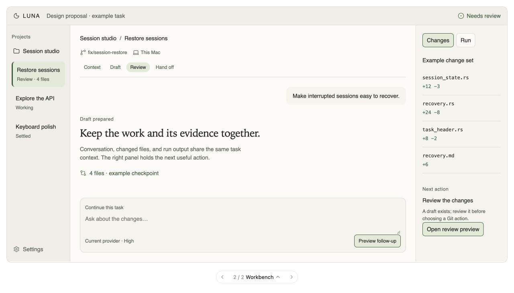
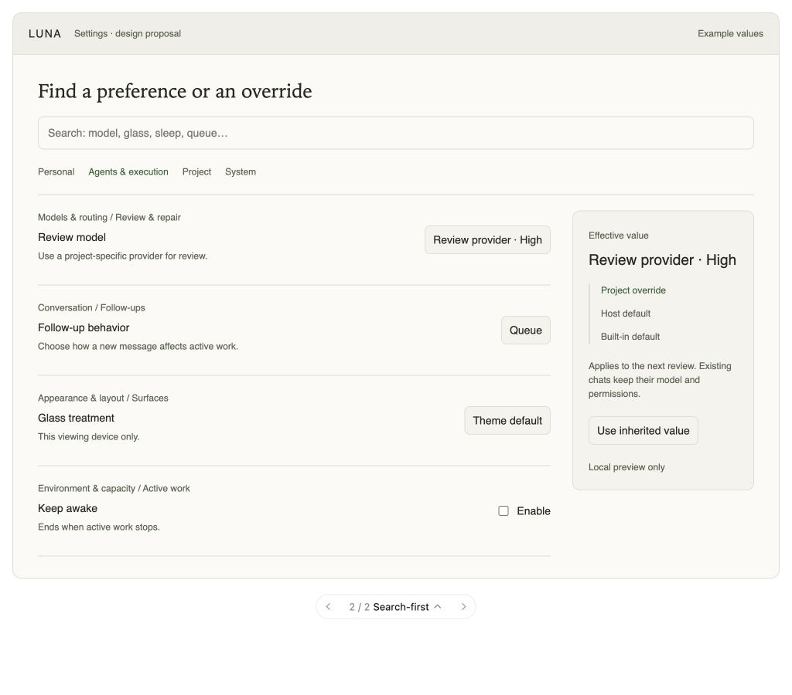
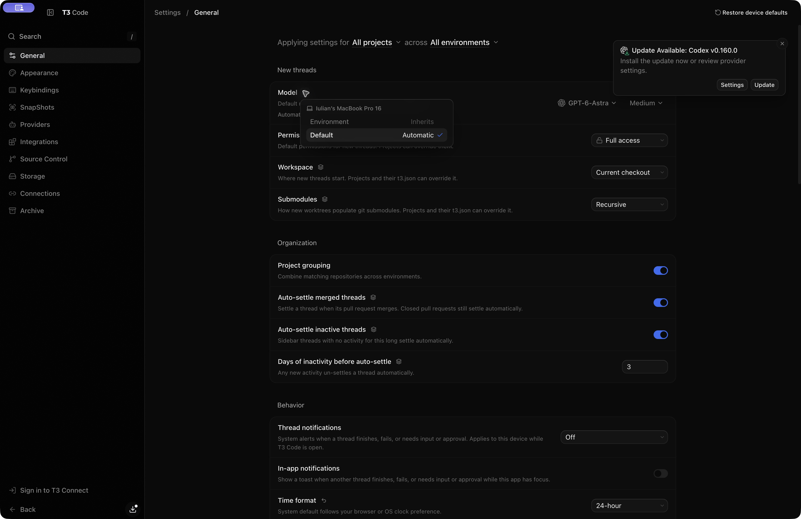
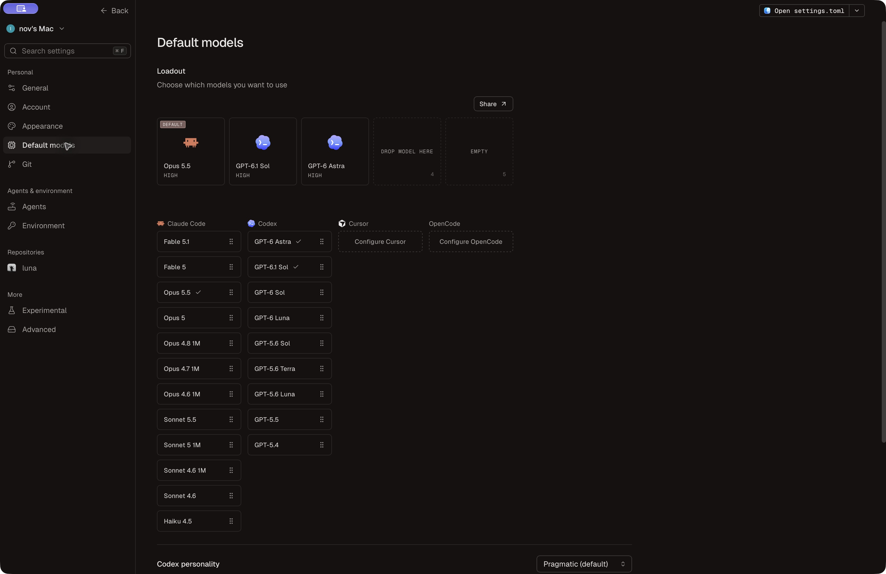
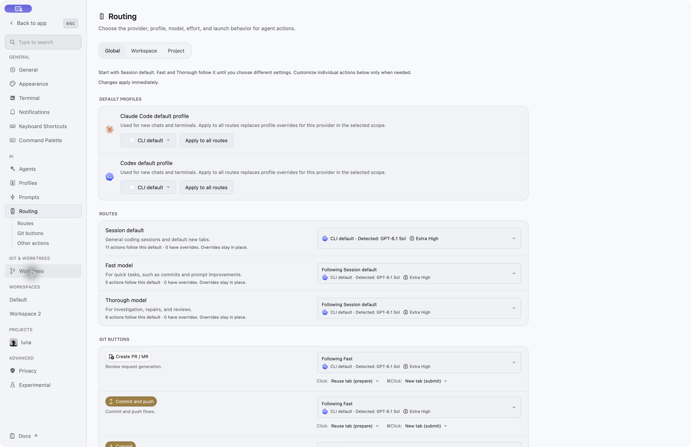
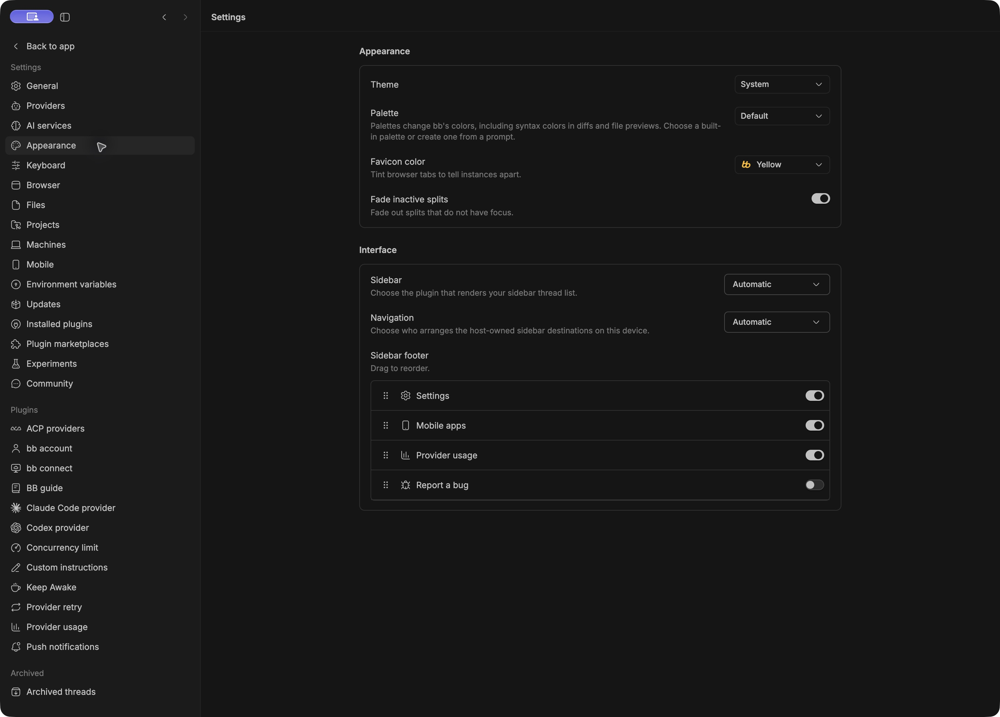
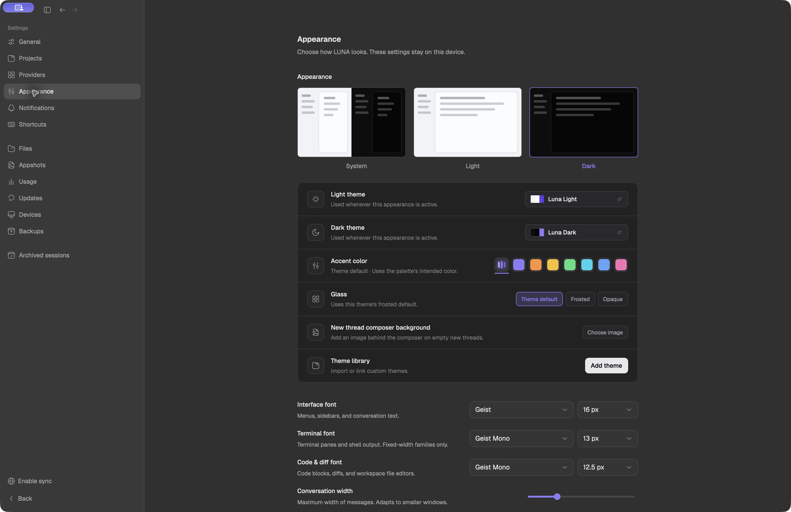

# Agent workspace apps: what LUNA should borrow

Research date: **2026-10-04** (Europe/Bucharest).

**Recommendation:** combine T3's settings and attention clarity, Conductor's setup/run/review continuity, super.engineering's workbench and action routing, and BB's explicit orchestration controls. Keep LUNA's native, local-first foundation.

LUNA already has many of the necessary primitives. The biggest immediate opportunity is to make them coherent, discoverable, and visually recognizable. Adding dozens of toggles or copying another app's whole layout would miss that opportunity.

## Read the research

1. [Product and UI findings](product-findings.md): what makes each app distinctive, source-backed workflows, visual ideas, and tradeoffs.
2. [Settings analysis](settings-analysis.md): existing LUNA capabilities, a detailed gap matrix, proposed organization, and a row/scope contract.
3. [Prioritized LUNA opportunities](luna-opportunities.md): fifteen opportunities, existing foundations, design directions, delivery order, failure cases, and proposed E2E evidence.
4. [Evidence and source ledger](sources.md): installed versions, immutable upstream revisions, source pointers, official docs, and observation limits.

## The strongest ideas

| Borrow from | Idea | Best LUNA adaptation |
| --- | --- | --- |
| T3 | Search opens the exact setting; values explain their source | One settings registry with aliases, anchors, scope, provenance and reset |
| Conductor | Clear workspace origin, run path and model loadout | Startup receipt, visible project commands, small provider-aware favorites |
| super.engineering | Persistent workbench, fast/thorough action routes, contextual Git action | Focus/Build/Review layouts and deliberate session/writing/review routes |
| BB | Named workflow phases, queued-capacity reasons, cancellable recovery | Operator controls built on existing tasks, hosts and durable journals |

These are interpretations and recommendations. Detailed evidence labels appear in the individual findings.

## What settings are actually missing

The best first additions are:

- Search across names, descriptions and aliases, with navigation to the row.
- Clear ownership: this viewing device, execution host, project, or current chat.
- Effective-value provenance and reset-to-inherit.
- Model defaults for distinct action classes. Favorites and per-provider new-chat defaults already exist.
- Unified read-only diagnostics and storage accounting.
- A small set of layout and conversation presentation preferences.

LUNA already has theme import, independent fonts, glass choices, queue/steer, notifications, backups, project defaults, and project commands. Sidebar auto-settle/organization also exists outside Settings. These need discovery and refinement rather than replacement.

The settings report distinguishes **Existing**, **Partial**, **Gap**, and **Audit** so uncertain items do not become a false backlog.

## Proposed visual direction

Use a recognizable task header, restrained contextual color, a calm reading column, and a purposeful run/review area. Give settings an always-visible search entry and explainable value sources. Retain a quiet Focus mode for reading; use Build and Review layouts when those workflows benefit from more visible context.

The following are **illustrative design proposals**, not screenshots of implemented LUNA features:

### Workspace proposal

### Settings proposal

Interactive alternatives are shown alongside the research in the current chat. Their controls are local presentation previews and do not start agents or change application preferences.

## Actual UI evidence

These captures show the installed applications inspected during this run:

### T3: explainable settings

### Conductor: a compact model loadout

### super.engineering: actions have routes

### BB: settings can extend the workspace

### LUNA: the existing foundation

## Verification boundary

BB and T3 source were inspected at fresh immutable upstream snapshots. All four competitor apps and LUNA's running settings were inspected. T3 search-to-control navigation and the inheritance popover were exercised read-only. Layout sketches were rendered and checked through their local interactions and responsive reflow. Source links, local report links, script syntax, and saved evidence hashes were checked; see `evidence/verification.json`.

No provider task, Git action, setup/run script, settings mutation, update, or cloud workflow was triggered in the inspected applications. This is research and design, not a feature implementation. LUNA runtime code and unrelated working-tree changes were preserved; no build, app refresh, commit, or push is claimed.
