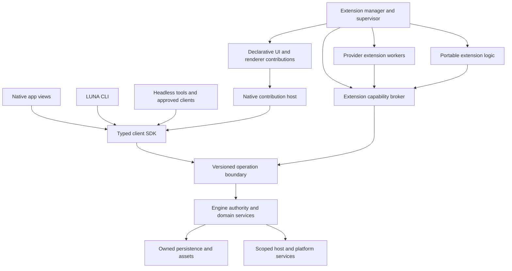

# Target core and extension architecture

This is a proposed LUNA design. Names and interfaces below are targets, not
existing APIs. CORE-00 settles the narrow runtime/platform choices with working
prototypes and measurements before broad implementation.

The [CORE-00 decision](core-00/decision.md) now pins the first execution profile,
native trust policy and local budgets. In particular, its first Wasm profile uses
core modules with explicit LUNA imports and no WASI; component/WASI support below
remains a future versioned profile requiring its own evidence.

## 1. Core responsibility and dependency direction

The core owns the facts that must remain true when an extension fails, is
disabled, is updated, or is missing on another device:

| Owner | Responsibilities |
| --- | --- |
| Domain contracts | Stable identities; commands, outcomes and errors; capabilities; events/projections; extension/content schemas; compatibility rules. |
| Engine authority | Profile/task/checkout identity, permissions and principals, admission, durable receipts, run ownership, recovery and lifecycle supervision. |
| Persistence | Canonical journals/documents, schema migrations, transactional ownership, approved asset references and deletion/retention. |
| Host services | Brokered process/files/terminal/Git primitives, connections, credentials, clocks, resource budgets and OS-specific services. |
| Native shell host | Windows, input/focus/AX, virtualized containers, protected permission/recovery UI and registered contribution placement. |
| Extension manager | Package verification, explicit enablement/grants, instance/version ownership, activation, stop, update/rollback and safe mode. |

Providers, browser product behavior, diff/review workbench, optional renderers,
commands, settings pages, layouts and themes consume those services. Domain
features such as Board and automations may become feature modules without being
third-party plugins immediately. Their durable policy is not removed simply
because their UI is extensible.

Desired package direction: domain/protocol types have no GPUI, provider CLI or
engine implementation dependencies; the SDK depends on public contracts and a
transport; engine services depend on contracts/ports; adapters and extensions
depend on those ports/SDKs; the application composition root selects built-in
implementations. Ordinary views no longer import engine/provider implementation
modules. Do not create a new crate for every class: extract a crate when it has
a distinct dependency, lifetime, distribution or test boundary. Retain in-process
calls where appropriate behind the same service contracts; plugins do not turn
every internal operation into network RPC.

## 2. One public operation catalog, CLI and SDK

Extend the existing typed domain definitions into a reviewed operation catalog:
operation ID/version, typed request/result/error, query/command/watch kind,
target requirements, authority class, idempotency rules, cancellation/stream
semantics, size limits and capability/version availability. Generate the Rust
client, JSON schemas, SDK bindings and policy-coverage inventory from that
catalog. Handler dispatch remains ordinary domain code; generated lists do not
auto-authorize new methods.

Provide a reusable Rust SDK and a TypeScript authoring/client SDK first, with
Swift/native bindings consumed by the existing mobile owner where useful.
Cross-language bindings preserve the same null/unknown/error/ID semantics.
Document the schema version and publish SDK packages separately from the app.
A small supported SDK operation is stronger than a wrapper around arbitrary
`method: string, params: any` calls.

The CLI exposes discovery/status, typed read/watch and deliberate commands,
plus extension `new`, `validate`, `test`, `pack`, `install`, `enable`, `disable`,
`inspect`, `logs` and `rollback` operations. These command names are proposed.
The app's buttons and agent-accessible extension tools call the same services.
They never open core databases or route around admission. Preserve the existing
versioned `luna inspect --json` behavior and its scripts while extending it.

Commands carry stable request IDs, expected revisions and exact targets. A
timeout yields an unknown outcome that can be queried by receipt, not a new
command ID and blind resend. Watch subscriptions have bounded queues, disposal,
cursor/revision semantics and explicit repair after gaps. Distinguish request
acceptance, execution, provider acceptance and terminal completion.

## 3. Stable identities and capability discovery

Use stable namespaced provider, extension, contribution, command, renderer and
schema IDs. They are data, not Rust enum variants. Version/package hash is a
separate execution identity. Existing provider wire spellings remain aliases
with lossless migration; do not silently assign old conversations a new native
session, account, permission mode or command payload hash.

The registry distinguishes installed, enabled, compatible, available, activated
and healthy. Advertise model/reasoning/options schemas from the same provider,
account, executable and host that would execute the request. Unsupported
features are explicit capabilities, not provider-name conditionals or invented
fallbacks. Core still validates every operation against actual available
enforcement, grants and state; a manifest's capability claim is not proof.

Provider catalog changes publish generation-tagged updates. Enabling an
extension refreshes the normal picker without app restart or a compiled enum
edit. Stale responses from another host/account/generation are discarded.
Existing chats remain bound to their original provider identity. An unavailable
or removed provider leaves history readable and a clear recovery route.

## 4. Execution runtime and trust classes

Adopt a **versioned protocol boundary**, not the app's Rust ABI. Rust explicitly
does not promise stability for its native ABI, so exposing Rust trait objects,
GPUI entities or engine memory to independently built binaries is unsuitable
for the update-independent contract. [Rust Reference](https://doc.rust-lang.org/reference/items/external-blocks.html#abi).

The proposed first release has three explicit contribution classes:

1. **Data-only:** themes, icons, settings schemas, command declarations and
   layouts. Validate schemas/assets without starting executable code.
2. **Portable executable logic:** bounded Wasm component modules using an
   explicit host-import surface. Wasmtime is the first candidate to benchmark;
   resource metering, host-call cancellation and hard memory/queue limits are
   mandatory. Choose/pin a supported component/WASI version after CORE-00.
3. **Native/provider workers:** supervised subprocesses with a versioned
   handshake/framed protocol. This permits extraction of existing Rust adapters
   and other language/CLI integrations without loading them into the UI process.
   Native execution has a clearly stated trust level and platform enforcement.

Wasm imports can enforce a capability boundary, but any permitted host import
can expose too much authority if designed poorly. Wasmtime documents filesystem
capabilities and sandboxing; CPU/memory interruption must be configured and
tested, not inferred from merely using Wasm.
[Wasmtime security](https://docs.wasmtime.dev/security.html),
[runtime configuration](https://docs.wasmtime.dev/api/wasmtime/struct.Config.html).

A native process normally inherits user-level OS authority unless a real OS
sandbox is applied. A manifest, separate process or JSON-RPC connection does
not restrict its ambient filesystem/network access. New native code therefore
requires explicit trust, or a demonstrated platform confinement mechanism.
Provider CLI behavior and LUNA broker grants remain separate layers. Never show
a native extension as sandboxed merely because its broker calls are scoped.
[WASI security model](https://wasi.dev/security).

Keep SDKs language-neutral at the wire. TypeScript examples require an available,
compatible runtime; Rust/Wasm authors require a build toolchain. The authoring
UI detects and explains missing tools and obtains any necessary installation
consent. It does not promise compilation on a machine with no toolchain.

## 5. Provider extension contract

The contract has a mandatory minimal profile and negotiated optional profiles:

| Area | Contract |
| --- | --- |
| Discovery | Stable provider/model IDs, capabilities, settings/options schemas, executable/account provenance and availability errors. |
| Run | Admitted run/turn/request context, prompt/attachment references, normalized bounded events and authoritative terminal status. |
| Inputs | Questions, approvals, ordinary follow-up and steer are distinct, correlated operations with cancellation and stale-response refusal. |
| Continuity | Resume identity, fork, rewind, compaction, child control and native goals only when independently supported. |
| Tool delivery | Existing LUNA tool/runtime context through the host broker; exact run/grant/request identities and secret-result handling. |
| Accounts | Scoped credential handles and provider-owned login operations; credentials remain host/provider-owned. |
| Lifecycle | Stop, crash, uncertain acceptance, warm-session compatibility, update/version pin and detached-child policy. |
| Observability | Structured bounded logs, health, usage and error facts without tokens or private transcript leakage. |

Existing `Harness` behavior is the migration source, not a requirement that
every custom provider support every feature. A generic adapter must not invent
safe resume, accepted steering or successful completion when the CLI cannot
prove it. Preserve provider-specific peer recordings and real native acceptance.

A run pins its provider package hash, API version, executable identity and
account context. Updating a package cannot replace the worker under an active
turn. Drain or explicitly stop it, reconcile unknown delivery, then activate
the new version. Core journals remain authoritative if a worker crashes.

## 6. UI, sidebar, settings and theme contributions

Create a contribution registry with stable IDs, placement, ordering, visibility
conditions, context/host requirements, preferences, lifecycle and fallback.
First slots: commands/keybindings/menus, model catalog, settings sections,
sidebar sections and alternative sidebar presentation, workbench tabs/panels,
task/header/status contributions and message renderers. Namespace conflicts
are explicit errors. A user chooses between competing defaults.

The native host owns GPUI entities, thread affinity, focus, AX, scrolling,
window lifetime and protected prompts. Plugins submit declarative view models
and actions, receive scoped events, and perform expensive work off the render
thread. No synchronous plugin callback is allowed to stall each paint. Bound
tree size, subscriptions, images and update frequency; virtualize large lists.

An alternate sidebar receives the same authorized project/task projection and
commands as the default sidebar. It can change grouping, layout, labels and
permitted actions while retaining source identity and stable selection. It
cannot spoof or hide the host's approval/permission/safe-mode controls. The
Extensions recovery entry remains reachable from a protected command/menu.

Reuse `luna-theme` tokens, imports and last-known-good persistence. Separate
appearance preferences from executable privileges. A custom layout must pass
keyboard/AX, reduced-motion, theme/contrast, narrow-window and draft-retention
acceptance. General custom content can use an isolated web surface through the
IC owner; the ordinary browser is a different capability and storage context.

This combines host-owned contribution points with isolated custom content, a
pattern also used by VS Code's extension API. It is a LUNA proposal, not a claim
that VS Code or Zed exposes every desired LUNA surface.
[VS Code contribution model](https://code.visualstudio.com/api/extension-capabilities/overview).

## 7. Durable plugin content and video

Add a versioned content envelope to the existing message/artifact model:
content type/renderer ID, schema version, stable message/part identity, owner
task/host, immutable authorized asset references, bounded public metadata,
fallback summary and reader requirements. Exact field names follow CORE-01/14.

The engine owns persistence and access. A renderer receives only its permitted
content; it cannot reinterpret a file path as a read grant. Unknown/disabled
renderers preserve content and expose a safe fallback. Fork, rollback, archive,
deletion, sync, remote fetch and migration have defined reference lifetimes.
Keep private output and omitted computer-use data under the existing policy.

CORE-14 owns the generic envelope/renderer registration; IC-1 owns its planned
immutable HTML service and isolated rendering implementation. SW-09 consumes
the same reference boundary for returned media. CORE-15 is a real video plugin
demonstration using those reviewed primitives, with playback/seek, resource
release outside the viewport, offline/unavailable handling and export fallback.
No second artifact database, arbitrary live DOM persistence or unrestricted
MCP bridge is introduced.

## 8. Package and instance lifecycle

Proposed manifest fields include package ID/version/publisher, content hashes,
core/SDK API range, platform/architecture/runtime requirements, declared
capabilities/contributions, dependencies, settings/data schema versions and
provenance/license information. Exact executable entry points must be within
the reviewed package. Reject archive traversal, escaping links, duplicates,
tampering, incompatible API versions and unresolved/cyclic dependencies.

Keep packages outside the signed app bundle. Installation and execution are
different states: stage → verify → installed/disabled → permission review →
enabled → compatible/activated or failed/quarantined. Local development packages
show their origin; registry signing establishes provenance, not harmlessness.
No public marketplace/backend is a prerequisite for local plugins.

Separate installation scope (host/device) from enablement/settings scope
(user/profile/project) and from individual execution grants. A remote execution
host owns its provider packages and credentials; a viewing client owns its
presentation components. Sync may carry references/preferences, never executable
activation grants, binaries or secrets by accident. Missing components produce
honest capabilities/fallbacks.

Upgrade stages and validates a new immutable package before switching a
compatible idle instance. Keep active runs pinned. Require renewed consent for
expanded grants. Plugin-owned data has namespaced migrations and recovery;
uninstall and data erasure are distinct. A failed update returns to a valid
version or quarantine without replaying provider side effects. Rollback cannot
silently read a newer irreversible schema. Safe mode starts the core with
optional extensions disabled and permits diagnosis/restoration.

## 9. Build a plugin from inside LUNA

The agent uses ordinary scoped project tools and a public SDK template to
produce source, a manifest, tests and a packed candidate. The dev host validates
it in a disposable profile and exercises its declared contributions. The app
shows the exact package hash, origin, capability changes, results and limitations.
Only explicit user enablement activates the candidate in the real profile.
Bind that approval to the package hash, version and requested grants through a
host-owned confirmation receipt. An agent/plugin-supplied `confirmed: true`,
forged user actor, old approval or changed candidate cannot satisfy enablement.

The generator's output is untrusted code. Test success does not authorize new
permissions, installation of extra tools, host mutation or publication. Preview
must not carry credentials from the current conversation. A provider template
must successfully list and run the selected actual CLI; a hard-coded model row
alone is not a working provider extension.

MCP connections keep their current provider/Executor owner. A LUNA extension
that consumes an integration uses its existing discovered connection and scoped
authority; it does not copy credentials or create a duplicate direct MCP
registration as an installation shortcut.

## 10. Decisions and promises

Settled by this plan: one authoritative core; public versioned SDK/operation
contracts; dynamic IDs and contribution points; explicit enablement; independent
package updates; preserved default experience and current data; gradual migration
with exact behavior/performance gates.

CORE-00 must resolve through prototypes: selected Wasm/runtime version and
startup footprint; first supported native-worker sandbox/trust policy per OS;
declarative native UI primitives; first external-provider distribution format;
and current absolute/relative performance budgets. These are bounded technical
decisions within the requested architecture, not grounds for building all
possible runtimes or asking for permission on every implementation detail.

Later product scope: public marketplace, commercial signing/governance, arbitrary
new native widget code, cloud execution, browser/Android client expansion and
running third-party native code on iOS. Keep those separate from proving the
desktop core, CLI, SDK and local extension workflow.
