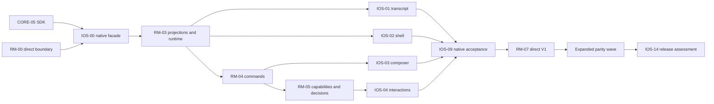

# iOS ownership and queue integration

The new `ios` group contains IOS-00–IOS-14. This is a native presentation,
integration and acceptance layer over the existing core/remote plan.

## Foundation and first release

| Owner | Precise responsibility |
| --- | --- |
| CORE-01/04/05 | Stable types/identity, dynamic provider facts and public SDK. |
| RM-00 | Approved direct architecture, authority map and harmless physical boundary prototype. |
| IOS-00 | Owned iOS build/FFI/native transport facade and app/data compatibility. Depends on CORE-05 and RM-00. It does not implement a second connection runtime. |
| RM-03 | Host projections, one shared connection/cache/reconnect runtime and a minimal native read slice. Now also depends on IOS-00. Full native transcript/shell migration is IOS-01/02. |
| RM-04 | Host command admission, durable outbox/receipts and setup/queue semantics through the client API. IOS-03 owns the full native composer and queue interaction. |
| RM-05 | Actual provider/permission/request projection and decision admission. IOS-04 owns the complete picker/question/approval UI. |
| RM-06 | Authorized attachment/file/diff operations and the first phone file/diff surface. IOS-03/06 consume those typed assets/metadata. |
| IOS-01/02/03/04 | Native transcript, adaptive shell, composer/queue and interactions. |
| IOS-09 | First-release native device/AX/input/performance acceptance for those surfaces. |
| RM-07 | Overall direct-Mac first release, including host power/lifecycle and real nearby/cellular routing. It now waits for IOS-01–04 and IOS-09 as well as its host dependencies. |

This explicitly refines the older RM prose that bundled every native screen into
the same host task. A thin native/SDK contract probe can close RM-03/04/05 only
for its specified backend/client boundary; it cannot close IOS UI work or RM-07.
Never build a second client outbox, parser owner, provider catalog or task store.

## Existing tasks refined by the new evidence

- **RM-03:** incorporate Zeron's immutable projection/frame-coalescing and
  viewport-independent delivery lessons within the approved direct SDK; keep
  host/profile identity and generation fences. Full renderer belongs to IOS-01.
- **RM-04:** incorporate suspension/lost-reply/host-wake and setup/worktree
  races. LUNA's host receipt is authoritative; don't copy Zeron's edge nudge
  protocol or T3's exact outbox representation.
- **RM-05:** remove runnable inference from phone static catalog fallback;
  project actual account/model/permission/approval/unknown-provider capability.
- **RM-06:** use typed host file metadata, authorized references and exact diff
  revisions. Neither file chip icons nor client-guessed paths grant access.
- **RM-08, RM-09, RM-11:** activate the already specified terminal, Git/thread
  tools and read-first phone operations tasks for the requested expanded parity
  wave. All wait for RM-07 and IOS-02; their narrower existing dependencies remain.
  Activating these development records does not authorize live Git writes,
  account changes, host updates or infrastructure deployment during QA.
- **RM-12:** remains Deferred and owns the optional cross-client awareness/
  service/registration/privacy contract. Native sharing is IOS-10; dictation,
  conversational voice and native push/widgets are IOS-11/12/13. The new tickets
  are the single iOS implementation owners for those surfaces.
- **ZI-03:** remains the normalized checklist owner; IOS-06 consumes its result.
- **IC-3/4/5 and CORE-14/15/21:** own durable content, live MCP App authority,
  Find semantics, generic renderer compatibility and host/client capability;
  IOS-06/07 are native consumers, not duplicate backends.

## New ticket ordering

The catalog contains all hard dependencies. CORE-00 remains the default next
task. Native rich-content, Board and search work does not block the first
direct release unless explicitly promoted into its required set. IOS-14 covers
the selected expanded wave, including RM-08/09/11, and reports every remaining
deferred row honestly.

## Remaining decisions

IOS-11/12/13 stay Deferred: local dictation device/locale policy, host-based live
voice, and owned push/Live Activity/widget services are different choices. Use
SW-16 and RM-12 for their requirements/architecture decisions; do not add an
implicit relay to ship them. If selected, activate the exact native tickets and
add them to the release gate before claiming their parity.

LUNA's current iOS 26 floor, bundle identity, data and signing ownership are
preserved. A lower deployment target, Android, web companion, public marketplace
or running downloaded desktop plugins on iOS is separate scope. A host-installed
provider plugin should still appear generically on the phone through the SDK.
T3 controls do not revive LUNA's cancelled Plan/Build workflow, retired provider
adapters or a new projectless schema. Display supported native plan/checklist
content through its current owner and reuse the existing project/folder model.
