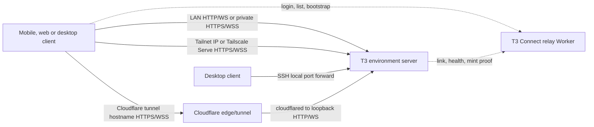

# T3 Code remote transport and network topology

Source snapshot: `pingdotgg/t3code` at `a8bdfdb54181fb5c9d43f2747112c137a804d016`, inspected locally on 2026-10-11. This is a source and documentation review, not a live deployment test. Source links below pin that snapshot. Scope: transport and reachability.

## Core model

Every client connects to an **environment** server using HTTP plus WebSocket. That host owns provider processes, execution, files and durable state; changing network routes does not move the workload. The stable environment ID identifies the server independently of its URL. A client can save several ordered routes to one ID. [Remote architecture, lines 1–18](https://github.com/pingdotgg/t3code/blob/a8bdfdb54181fb5c9d43f2747112c137a804d016/docs/internals/remote.md#L1-L18) A source check of the resolver confirms that direct bearer, relay and SSH profiles all produce the same prepared HTTP and socket connection shape. [Resolver, lines 120–261](https://github.com/pingdotgg/t3code/blob/a8bdfdb54181fb5c9d43f2747112c137a804d016/packages/client-runtime/src/connection/resolver.ts#L120-L261)

The diagram's T3 Connect solid path is **not a direct client-to-host network path**: it traverses Cloudflare's managed tunnel. The relay **Worker** is outside ordinary application HTTP/WS forwarding, after bootstrap. A webhook forwarding exception and optional offline webhook queue do use that Worker. [T3 Connect architecture, lines 1–30](https://github.com/pingdotgg/t3code/blob/a8bdfdb54181fb5c9d43f2747112c137a804d016/docs/internals/t3-connect.md#L1-L30); [relay README, lines 6–25](https://github.com/pingdotgg/t3code/blob/a8bdfdb54181fb5c9d43f2747112c137a804d016/infra/relay/README.md#L6-L25).

## Four route families and their requirements

| Route | Actual path and setup | Reachability, TLS, and client limits |
| --- | --- | --- |
| Direct LAN, VPN, or public HTTPS | Desktop host enables **Network access**, or CLI binds `t3 serve --host <private-ip>`. `t3 pair` can mint a link for an already-running host. The remote device uses the host's reachable IP/DNS URL. [User guide, lines 33–63](https://github.com/pingdotgg/t3code/blob/a8bdfdb54181fb5c9d43f2747112c137a804d016/docs/user/remote-access.md#L33-L63) | LAN HTTP/WS is supported where the client can reach that port; network and firewall must allow it (inference from direct socket path). For a public URL, operator must arrange ingress and HTTPS if needed. Loopback never reaches another device. The server classifies non-loopback binds as remote-reachable. [Server auth host classification, lines 67–81](https://github.com/pingdotgg/t3code/blob/a8bdfdb54181fb5c9d43f2747112c137a804d016/apps/server/src/auth/utils.ts#L67-L81) |
| Tailscale IP or Serve HTTPS | Both devices join the same tailnet. T3 catalogs raw tailnet IPv4 as an HTTP endpoint route. `t3 serve --tailscale-serve` or desktop **Tailscale HTTPS** configures `tailscale serve --bg --https=<port> http://127.0.0.1:<localPort>` and advertises a MagicDNS `https://…ts.net/` endpoint after a probe. `t3 pair --tailscale` can create/repair the mapping for an existing server. [User guide, lines 122–148](https://github.com/pingdotgg/t3code/blob/a8bdfdb54181fb5c9d43f2747112c137a804d016/docs/user/remote-access.md#L122-L148); [Tailscale command, lines 341–380](https://github.com/pingdotgg/t3code/blob/a8bdfdb54181fb5c9d43f2747112c137a804d016/packages/tailscale/src/tailscale.ts#L341-L380); [desktop endpoints, lines 26–97](https://github.com/pingdotgg/t3code/blob/a8bdfdb54181fb5c9d43f2747112c137a804d016/apps/desktop/src/backend/tailscaleEndpointProvider.ts#L26-L97) | Serve gives tailnet HTTPS and a trusted browser context, but says nothing about whether the tailnet underlay is peer-to-peer or relayed; Tailscale **Funnel is not implemented** as a product route in this snapshot: search of the source for `tailscale funnel` and `funnel` found no transport implementation. A `100.64/10` IP alone is not proof of Tailscale: WARP can overlap, so the product verifies Tailscale status for labeling. [User guide, lines 65–70](https://github.com/pingdotgg/t3code/blob/a8bdfdb54181fb5c9d43f2747112c137a804d016/docs/user/remote-access.md#L65-L70); [Tailscale status parser, lines 194–215](https://github.com/pingdotgg/t3code/blob/a8bdfdb54181fb5c9d43f2747112c137a804d016/packages/tailscale/src/tailscale.ts#L194-L215) |
| Desktop-managed SSH | Desktop asks SSH to start or reuse a T3 server on a Linux/Apple Silicon host, then creates `ssh -L <localPort>:127.0.0.1:<remotePort>`, exposing local `http://127.0.0.1:<localPort>/` and WS to the shared client runtime. The remote host owns projects and providers. First launch downloads the server archive. [User guide, lines 160–180](https://github.com/pingdotgg/t3code/blob/a8bdfdb54181fb5c9d43f2747112c137a804d016/docs/user/remote-access.md#L160-L180); [SSH command, lines 1142–1161](https://github.com/pingdotgg/t3code/blob/a8bdfdb54181fb5c9d43f2747112c137a804d016/packages/ssh/src/tunnel.ts#L1142-L1161); [local HTTP/WS mapping, lines 1499–1534](https://github.com/pingdotgg/t3code/blob/a8bdfdb54181fb5c9d43f2747112c137a804d016/packages/ssh/src/tunnel.ts#L1499-L1534) | This setup is **desktop-managed**, requiring a native SSH process and prompt handling; mobile can connect to an already reachable server but does not launch this SSH connection itself through the shared resolver. The remote SSH port must be reachable; T3's own server is loopback on that host. T3 stops a server it launched and leaves an existing server running on removal. [Remote architecture, lines 78–84](https://github.com/pingdotgg/t3code/blob/a8bdfdb54181fb5c9d43f2747112c137a804d016/docs/internals/remote.md#L78-L84) |
| T3 Connect | Host links its environment to a Clerk cloud account, receives a managed Cloudflare tunnel and runs `cloudflared` pointing public hostname ingress at a validated loopback HTTP origin. Client signs in to the same account, discovers the linked environment, obtains a relay-brokered bootstrap credential, exchanges it **with the environment** for a proof-bound environment session, then uses the tunnel hostname for HTTP/WS. [User guide, lines 6–31](https://github.com/pingdotgg/t3code/blob/a8bdfdb54181fb5c9d43f2747112c137a804d016/docs/user/remote-access.md#L6-L31); [relay trust boundary, lines 35–63](https://github.com/pingdotgg/t3code/blob/a8bdfdb54181fb5c9d43f2747112c137a804d016/docs/internals/t3-connect.md#L35-L63); [managed ingress and DNS, lines 1135–1201](https://github.com/pingdotgg/t3code/blob/a8bdfdb54181fb5c9d43f2747112c137a804d016/infra/relay/src/environments/ManagedEndpointProvider.ts#L1135-L1201) | No router port forwarding, but it requires the vendor cloud service, Clerk identity, Cloudflare tunnel/edge and a running host connector. The relay signs mint requests and is a trusted broker. A healthy WebSocket is not replaced for HTTP credential renewal. [T3 Connect architecture, lines 35–56](https://github.com/pingdotgg/t3code/blob/a8bdfdb54181fb5c9d43f2747112c137a804d016/docs/internals/t3-connect.md#L35-L56); [connection runtime, lines 29–44](https://github.com/pingdotgg/t3code/blob/a8bdfdb54181fb5c9d43f2747112c137a804d016/docs/internals/connection-runtime.md#L29-L44) |

### T3 Connect control versus application data

1. Host links to account and configures managed tunnel. Relay provisions a named Cloudflare tunnel, proxied DNS CNAME and ingress that accepts only its allocated hostname, forwards to a validated `localhost`/`127.0.0.1`/`::1` HTTP port, and otherwise returns 404. [Managed origin validation, lines 374–389](https://github.com/pingdotgg/t3code/blob/a8bdfdb54181fb5c9d43f2747112c137a804d016/infra/relay/src/environments/ManagedEndpointProvider.ts#L374-L389); [ingress and DNS, lines 1135–1201](https://github.com/pingdotgg/t3code/blob/a8bdfdb54181fb5c9d43f2747112c137a804d016/infra/relay/src/environments/ManagedEndpointProvider.ts#L1135-L1201).
2. Client cloud identity and DPoP proof authorize a relay `connectEnvironment` request. Relay asks the linked environment to mint a one-use credential. Client exchanges that credential at the environment `/oauth/token`, checks its environment ID, and obtains an environment access token. [Client authorization, lines 278–359](https://github.com/pingdotgg/t3code/blob/a8bdfdb54181fb5c9d43f2747112c137a804d016/packages/client-runtime/src/authorization/service.ts#L278-L359); [trust boundary, lines 35–56](https://github.com/pingdotgg/t3code/blob/a8bdfdb54181fb5c9d43f2747112c137a804d016/docs/internals/t3-connect.md#L35-L56).
3. Client sends subsequent environment HTTP and WebSocket requests to the tunnel hostname. WebSocket bearer/DPoP flows first request a short-lived ticket over authenticated HTTP, keeping the long-lived token out of the socket URL. DPoP proofs sign the URL in use, so the same environment token can also authorize a learned LAN route. [Environment auth, lines 21–24 and 52–62](https://github.com/pingdotgg/t3code/blob/a8bdfdb54181fb5c9d43f2747112c137a804d016/docs/internals/environment-auth.md#L21-L24); [authorization service, lines 72–80 and 218–248](https://github.com/pingdotgg/t3code/blob/a8bdfdb54181fb5c9d43f2747112c137a804d016/packages/client-runtime/src/authorization/service.ts#L218-L248).

Security precision: HTTPS/WSS on Tailscale Serve or the Cloudflare hostname protects those network legs. Managed tunnel config forwards to **local HTTP**, and the source does not show application-level end-to-end content encryption across Cloudflare. We should not describe T3 Connect as end-to-end encrypted or claim that Cloudflare cannot process application bytes. Cloudflare's product-level processing and TLS termination deserve separate live vendor-document verification if they become design requirements. The relay Worker does not itself handle ordinary HTTP/WS payloads, which is a narrower, source-supported claim. Direct LAN HTTP and SSH-forwarded HTTP do not become HTTPS merely because their clients authenticated. [T3 Connect architecture, lines 3–11](https://github.com/pingdotgg/t3code/blob/a8bdfdb54181fb5c9d43f2747112c137a804d016/docs/internals/t3-connect.md#L3-L11); [managed ingress, lines 1143–1150](https://github.com/pingdotgg/t3code/blob/a8bdfdb54181fb5c9d43f2747112c137a804d016/infra/relay/src/environments/ManagedEndpointProvider.ts#L1143-L1150).

## Pairing QR and hosted web

`t3 pair` discovers a running server, issues a credential, builds a URL and prints it as QR. It warns if the URL points at loopback, because scanning a correct link from another device does not make the backend reachable. The link grants a session; it does not forward traffic, expose a port or configure TLS. Each new device uses a fresh one-time pairing link, while the paired session persists for reconnection. [Pair CLI, lines 479–529](https://github.com/pingdotgg/t3code/blob/a8bdfdb54181fb5c9d43f2747112c137a804d016/apps/server/src/cli/pair.ts#L479-L529); [user guide, lines 54–63](https://github.com/pingdotgg/t3code/blob/a8bdfdb54181fb5c9d43f2747112c137a804d016/docs/user/remote-access.md#L54-L63).

The hosted `app.t3.codes` UI is itself a browser client, with browser-local connection catalog. It does not proxy the user's environment through its origin. A hosted pairing URL puts the backend address in the query and pairing secret in the fragment, which is stripped after exchange. Because the hosted page is HTTPS, it needs an HTTPS environment endpoint: an HTTP LAN URL will run into browser mixed-content restrictions even if LAN connectivity exists. [Remote architecture, lines 58–69](https://github.com/pingdotgg/t3code/blob/a8bdfdb54181fb5c9d43f2747112c137a804d016/docs/internals/remote.md#L58-L69); [hosted pairing builder, lines 73–87](https://github.com/pingdotgg/t3code/blob/a8bdfdb54181fb5c9d43f2747112c137a804d016/apps/web/src/hostedPairing.ts#L73-L87); [user guide, lines 150–158](https://github.com/pingdotgg/t3code/blob/a8bdfdb54181fb5c9d43f2747112c137a804d016/docs/user/remote-access.md#L150-L158).

## Route choice, failover and address discovery

The client saves an ordered route list per environment. Initial rank is loopback, LAN, tailnet/VPN, public, SSH, then T3 Connect; the user can reorder. Direct routes receive a 2.5-second **unauthenticated** environment-descriptor check before sending a credential, reducing wrong-host exposure from a recycled LAN IP. Authorization has a separate ten-second same-URL descriptor cache, so this is not an absolute credential-safety guarantee; see [mobile runtime qualifications](04-mobile-runtime.md). A responsive matching route is attempted in order; a silent route is deferred, then attempted if others fail because the probe is imperfect. An incompatible server version stops the walk. [Route rank, lines 96–143](https://github.com/pingdotgg/t3code/blob/a8bdfdb54181fb5c9d43f2747112c137a804d016/packages/client-runtime/src/connection/routes.ts#L96-L143); [driver, lines 35–135 and 144–161](https://github.com/pingdotgg/t3code/blob/a8bdfdb54181fb5c9d43f2747112c137a804d016/packages/client-runtime/src/connection/driver.ts#L35-L161).

After connecting, the host reports bound LAN/tailnet addresses. Client adds them as learned routes, filters loopback and HTTP when the client context forbids insecure content, and removes learned routes no longer advertised. Saved manual routes remain. Learned routes reuse the direct pairing bearer or a T3 Connect DPoP credential. The latter is not origin-bound, because each proof names the specific URL. [Remote architecture, lines 46–53](https://github.com/pingdotgg/t3code/blob/a8bdfdb54181fb5c9d43f2747112c137a804d016/docs/internals/remote.md#L46-L53); [learned-route implementation, lines 236–338](https://github.com/pingdotgg/t3code/blob/a8bdfdb54181fb5c9d43f2747112c137a804d016/packages/client-runtime/src/connection/routes.ts#L236-L338).

While on a later route, the supervisor checks earlier **direct** routes on network changes, app foreground and a 60-second interval. It preflights authorization before switching and cools down a direct route that answered but failed to connect. Transient reconnects use jittered exponential backoff capped at five minutes; auth failures wait for a wakeup. [Supervisor, lines 40–54 and 348–377](https://github.com/pingdotgg/t3code/blob/a8bdfdb54181fb5c9d43f2747112c137a804d016/packages/client-runtime/src/connection/supervisor.ts#L348-L377); [connection runtime, lines 8–26](https://github.com/pingdotgg/t3code/blob/a8bdfdb54181fb5c9d43f2747112c137a804d016/docs/internals/connection-runtime.md#L8-L26).

**Documentation nuance:** the user guide says it checks earlier routes and moves back when one works [lines 85–89](https://github.com/pingdotgg/t3code/blob/a8bdfdb54181fb5c9d43f2747112c137a804d016/docs/user/remote-access.md#L85-L89). The code explicitly says SSH and T3 Connect lack a cheap check and cannot pass the proactive better-route preflight; they can be used on normal reconnect/failover. Thus “automatic move back” should be read as applying to earlier **direct** routes, not every saved route. This was cross-checked against both [driver route checks, lines 35–39 and 144–146](https://github.com/pingdotgg/t3code/blob/a8bdfdb54181fb5c9d43f2747112c137a804d016/packages/client-runtime/src/connection/driver.ts#L35-L39) and [supervisor, lines 348–351](https://github.com/pingdotgg/t3code/blob/a8bdfdb54181fb5c9d43f2747112c137a804d016/packages/client-runtime/src/connection/supervisor.ts#L348-L351).

## Operational requirements and failure modes

- **Host availability:** a signed-in account, saved pairing, QR, or remembered route cannot wake a stopped environment by itself. T3 Connect CLI setup offers a background service; saving login alone does not make it reachable. [User guide, lines 3–26](https://github.com/pingdotgg/t3code/blob/a8bdfdb54181fb5c9d43f2747112c137a804d016/docs/user/remote-access.md#L3-L26).
- **Tailscale:** client and host need membership in the same tailnet; Serve mapping and its HTTPS port need to be configured. A stale mapping can return 502/503/504, which the `pair --tailscale` path treats as repairable. [User guide, lines 122–148](https://github.com/pingdotgg/t3code/blob/a8bdfdb54181fb5c9d43f2747112c137a804d016/docs/user/remote-access.md#L122-L148); [pair probe, lines 205–229](https://github.com/pingdotgg/t3code/blob/a8bdfdb54181fb5c9d43f2747112c137a804d016/apps/server/src/cli/pair.ts#L205-L229).
- **SSH:** remote Linux/Apple Silicon, SSH access, shell tooling and provider CLIs are prerequisites. App update, SSH authentication and forward setup can fail independently of T3 environment auth. [User guide, lines 167–180](https://github.com/pingdotgg/t3code/blob/a8bdfdb54181fb5c9d43f2747112c137a804d016/docs/user/remote-access.md#L167-L180).
- **T3 Connect:** the tunnel URL is stable when a linked host sleeps or its tunnel is reclaimed and reprovisioned, but it is offline until the host/connector comes back. Cloudflare tunnel billing drives optional idle cleanup; default cleanup mode is **off** in this snapshot, so do not assume an operator enabled it. [T3 Connect architecture, lines 65–83 and 92–131](https://github.com/pingdotgg/t3code/blob/a8bdfdb54181fb5c9d43f2747112c137a804d016/docs/internals/t3-connect.md#L92-L131).
- **Proxy/origin:** OAuth issuer/resource URLs derive from the request's Host and `X-Forwarded-Proto`, letting one server answer over loopback, Serve and tunnel; a custom reverse proxy that rewrites Host or drops protocol header can break sign-in. [Environment auth, lines 52–55](https://github.com/pingdotgg/t3code/blob/a8bdfdb54181fb5c9d43f2747112c137a804d016/docs/internals/environment-auth.md#L52-L55).
- **Self-hosting / fresh clone:** the repository's fresh source build has T3 Connect disabled. Its `.env.example` contains **public** production Clerk identifiers and relay URL, so copying it enables source builds against the production deployment. It does not grant ownership or operator control of that deployment. A separate self-hosted T3 Connect needs Clerk public app/JWT/OAuth setup plus a deployed relay with Cloudflare DNS/tunnels, PlanetScale and runtime credentials, APNs/FCM if notifications are desired. [Setup, lines 7–35](https://github.com/pingdotgg/t3code/blob/a8bdfdb54181fb5c9d43f2747112c137a804d016/docs/operations/connect-setup.md#L7-L35); [.env example, lines 1–22](https://github.com/pingdotgg/t3code/blob/a8bdfdb54181fb5c9d43f2747112c137a804d016/.env.example#L1-L22); [relay deployment, lines 77–111 and 126–156](https://github.com/pingdotgg/t3code/blob/a8bdfdb54181fb5c9d43f2747112c137a804d016/infra/relay/README.md#L77-L111).

## Luna implications within the current constraint

The current Luna **Control this Mac** V1 requirement is direct-only, no relay. T3's clean transferable pieces for V1 are: a reachable host endpoint separate from pairing, an environment identity that survives address changes, a no-credential descriptor probe before reconnecting to an old LAN IP, HTTP and WebSocket on the same selected route, explicit route diagnostics, and a host-running/reachability check. If Luna offers an HTTPS web client, its host endpoint also needs HTTPS; a QR cannot solve browser mixed content. Multi-route ranking and learned LAN addresses are sensible future work only after the direct V1 path is reliable.

T3 Connect's Clerk account, DPoP bootstrap broker, Cloudflare managed tunnel, database allocations, connector recovery and billing cleanup represent a distinct hosted-service program. They should be a separately scoped future option rather than implicit V1 requirements. **Tailscale Serve is also a later optional transport**, outside Luna's established no-relay V1 boundary. It gives T3 a tailnet HTTPS endpoint that proxies to the local server, but that endpoint does not prove that the underlying tailnet connection is peer-to-peer: Tailscale may negotiate or fall back to a relayed path. The T3 source and documentation do not establish the underlay route used for a particular live connection. Tailscale Funnel and T3's vendor tunnel remain distinct choices. Desktop-managed SSH is another independent future route and would require native SSH lifecycle UX; it is not a mobile app transport feature by itself.

Unverified for this lane: actual production availability, tunnel cost/pricing amounts, firewall defaults on each OS, network performance, TLS termination policy at Cloudflare, and UI behavior on a physical mobile device. The source establishes mechanisms and documented UX but no live service guarantees.
