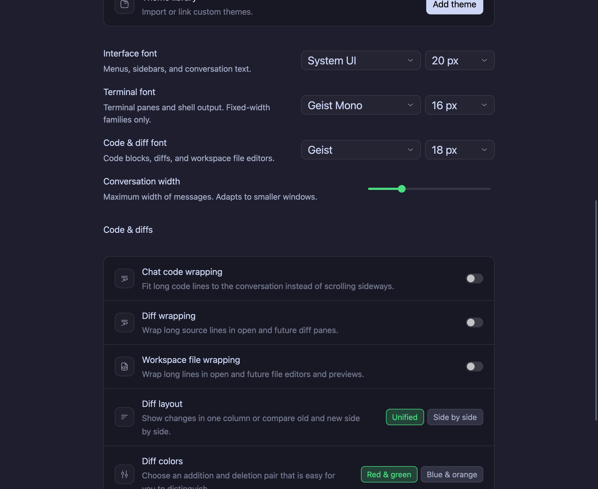
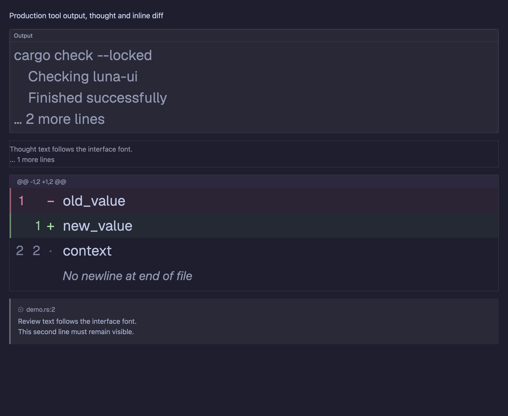
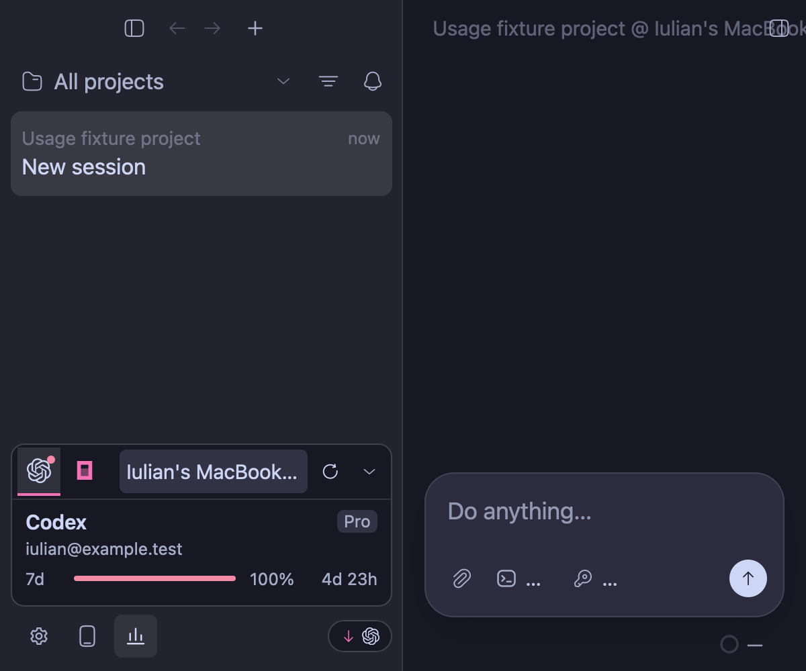

# Appearance consistency audit

Scope: the current UI and theme files touched by `noviulian` / `novnski` in Git,
compared with the app's shared settings rows, menus, controls and theme roles.
The initial checkout was clean at `8a47cebc`.

## Failure cases specified before the fixes

- A dark palette change leaves the compact Usage card or run button grey.
- Glass changes leave newly added cards opaque or introduce a foreign border tint.
- Interface font changes leave Appearance or Changes chrome in Geist.
- Interface size changes leave labels, actions, badges and tooltips at fixed pixels.
- Scaling a label without its line height or control height clips the label.
- Code-size changes leave diff gutters and metadata at their original size.
- Settings readback or startup reload loses the selected palette, surface or fonts.
- A standalone remote-read window bypasses the saved Appearance preferences.

## Repeatable acceptance

Use the repository's build wrapper and existing target cache:

```sh
scripts/cargo.sh build --locked -p luna-ui --features appshots-fixture \
  --example appearance-fixture --example usage-fixture \
  --example activity-attention-fixture --example drafts-fixture \
  --example history-operations-fixture
target/debug/examples/appearance-fixture /tmp/luna-appearance-page
target/debug/examples/usage-fixture /tmp/luna-appearance-usage 300 appearance-audit
```

Both fixtures run headlessly, render production views, and own temporary profiles.
The Appearance fixture exercises live changes, disk readback and startup reload.
The Usage fixture exercises rendered mouse actions and five light/dark palettes
with opaque/frosted surfaces, a system interface font at 20px, independent code
and terminal sizes, and actual screenshot pixels for the opaque card background.
PNG captures and machine-readable results are retained in the requested output
directories. These are E2E fixtures; no new unit tests are added.

## Audit result

Reviewed 106 current Rust files touched by the named Git authors and the shared
components their views use. The audit included settings, managed skills,
project commands, task confirmations, Activity, Usage, history, Changes/PR/Git
controls, composer/stash/recall, transcript tools, files, Markdown, terminal
chrome, menus and the remote-read window.

| Finding | Correction |
| --- | --- |
| Dark Usage and run controls retained fixed grey colours | Shared theme foreground, surface, border, accent and semantic roles in both appearances |
| Composer chip colours and loading spinner ignored palette/accent changes | Theme-owned warning, accent, success and glyph roles |
| Appearance, Changes, transcript tools and terminal chrome forced Geist | Selected interface family; independent code/terminal families remain in their content views |
| Fixed interface labels and leading bypassed size preferences | 177 explicit scalable text sites plus corresponding line boxes, badge heights and percentage columns |
| Larger text could overlap Appearance selectors | Constrained description width and wrapping |
| Code gutters, output, inline diffs and review-card folds used stale geometry | Code size drives technical rows; interface size drives prose, review cards and UI measurements |
| Standalone remote view bypassed settings | Shared startup initialization, saved themes/fonts/glass and OS appearance observation |

Shared radius/spacing recipes are retained according to context: compact
controls, inset menu rows, floating menus and panels keep their existing
hierarchy. Git/PR buttons and the Usage panel now refer to the shared radius
constants and themed interaction states. Fonts repaint all open windows, and
the resolved theme carries the interface size for calculated card heights.

Provider branding, platform icon fonts, image-overlay white and ASCII-art
coordinates remain intrinsic to those graphics. The only remaining fixed
text-size expressions in production UI source are the image progress overlay
and the scaled moon artwork; ordinary interface labels use the interface size.
Website content displayed inside the browser keeps its own authored styling.

## Verification and retained evidence

- Wrapper builds and checks use `--locked`; format, `git diff --check`, and
  Clippy for `luna-ui`/`luna` with all targets passed. Existing compiler/Clippy
  warnings remain. No new unit tests were added.
- Appearance E2E: production controls, 12/20px interface sizes, system/Geist
  families, independent code and terminal sizes, saved-settings readback,
  startup reload, and production output/thought/diff/review cards at 8/18/32px
  code sizes. All captures and result checks passed.
- Usage E2E: five palettes × opaque/frosted surfaces, rendered mouse actions,
  quota alert/dismissal, persisted preferences and actual opaque-card pixel
  assertions. The pre-fix pixel assertion failed against the grey card; the
  final matrix passes.
- Native Activity, composer chips and History fixtures produced reviewed
  captures at the saved 20px system interface font. Fixtures use isolated
  projects, provider stubs and data roots. Production accounts were not used.
- Live LUNA Dev controls changed to Light/Pink/Opaque/20px. Accessibility and
  disk readback agreed. All recorded primary Appearance preferences were
  restored exactly before the final refresh.

The native History fixture needed current project setup and the correct
engine data root. Its first new capture attempt caused a GPUI nested-update
crash by drawing through a typed window update. Capture now uses
`AnyWindowHandle`, matching the working fixtures; its final run exits 0. The
macOS crash report is retained with the local evidence. The computer-use tool
blocked access to User Notification Center, so the OS alert must be dismissed
manually with Ignore.

Full local evidence, 39 final PNGs, logs, preference readbacks, source inventory
and SHA-256 manifest:
`/Users/iulian/Desktop/LUNA-Appearance-Audit-2026-09-29/`.
The screenshots below are retained in the repository with their own manifest.





Native validation was on macOS. This is a styling/settings audit with
representative E2E scenes; it does not certify every provider operation or
native rendering on Windows/Linux. The remote-read settings path was source
reviewed and compiled; no live SSH connection was opened for this audit.
