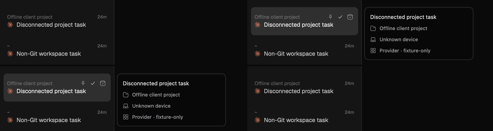
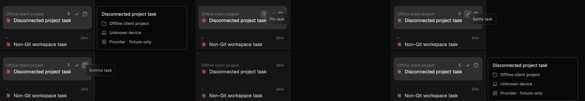
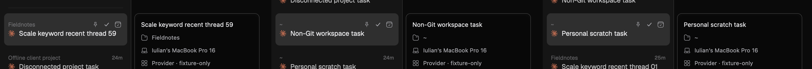

# Sidebar hover and detail card QA — 2026-09-25

## Repeat

From the repository root, use a fresh disposable profile:

```sh
qa_root=$(mktemp -d /tmp/luna-l12-sidebar-hover.XXXXXX)
LUNA_SIDEBAR_SCALE_QA=1 scripts/run-macos-l12-fixture.sh "$qa_root" build
LUNA_SIDEBAR_SCALE_QA=1 scripts/run-macos-l12-fixture.sh "$qa_root" run
cat "$qa_root/SIDEBAR-QA.json"
```

Open **LUNA L12 QA**. The manifest identifies 60 recent tasks. In the normal sidebar, hover **Scale keyword recent thread 59** and compare its position with the pinned rows above and **Non-Git workspace task** below. The row should keep its height and neighbors' positions. Pin, Settle, and Archive should appear together at the right edge as small icon controls. A completed task should show a green dot in place of the check and Done label, with a brighter title.

Keep the pointer over the row until its detail card opens. The card should start just beyond the sidebar's right edge and show title, project, device, model if configured, branch if available, and status. Hover Pin, Settle, Archive, the sidebar view control, Activity, Settings, and Devices to read their action tooltips. Archive a disposable recent task and confirm it leaves the active list.

Stop the fixture when finished:

```sh
LUNA_SIDEBAR_SCALE_QA=1 scripts/run-macos-l12-fixture.sh "$qa_root" stop
```

## Native readback

The isolated `sidebar-scale-v5` fixture built and ran with a valid signed bundle. On the completed **Scale keyword recent thread 59** row, hovering revealed Pin, Settle, and Archive as one compact group at the right edge. The pinned rows above, divider, and **Non-Git workspace task** below stayed in place. The status appeared as a green dot with no Done label in the row. The detail card opened to the right of the sidebar, showing the task title, **Fieldnotes**, **Iulian’s MacBook Pro 16**, **Provider · fixture-only**, and **Done**. Clicking Archive removed thread 59 from the active list in the first disposable run. The grouped-control check used a fresh disposable profile; no personal task was modified.

## Anchored tooltip follow-up

Hover a task's text and compare the top edge of its detail card with the top edge of its row. The card should open after about 300 ms, start beyond the sidebar's right edge, and leave the row highlighted. Move across Pin, Settle, and Archive: only the hovered control's tooltip should appear; the detail card must stay hidden throughout the action strip. Scroll or click before the detail delay expires and confirm no late card appears. For a row near the bottom of the window, the card may move upward enough to stay within the viewport.

The native `sidebar-scale-v5` fixture showed the card's top aligned to **Scale keyword recent thread 59** and the hover controls in the same row. The **Scale keyword recent thread 07** card stayed within the bottom edge by moving upward. An unselected **Non-Git workspace task** showed its hover wash and detail card together. The cursor-anchored transparent spacer that previously crossed the row is gone; the action strip is excluded from the detail trigger in the row geometry.

## Long-hover regression and failure cases

The supplied 20-second recording exposed a case the brief readback missed: at about 2.5 seconds, the detail card and action icons remain visible for **Luna Settings QA Readiness**, but the row wash disappears while the pointer is still over its text. Moving within the row can make the wash and card alternate. The action icons staying visible show that the row's hover state did not end; the cached fade state was pruned on a tooltip-triggered frame.

The repeatable check must cover these cases before considering the fix complete:

1. Hold the pointer motionless over an unselected row for at least four seconds. Its wash, title brightness, and detail card must remain steady after the 300 ms entrance.
2. Move within the row's text area. The detail card must not restart or flicker.
3. Move into the Pin/Settle/Archive strip. The detail card must close, with no flash between action buttons.
4. Leave the row. The wash, action icons, and card must clear.
5. Scroll or click before the tooltip delay expires. No stale card may appear.
6. A low row's card must remain within the window and not shift neighboring rows.

### Repeat the stationary-pointer capture

Use a fresh synthetic profile and leave the mouse alone while the fixture captures four production-rendered frames:

```sh
qa_root=$(mktemp -d /tmp/luna-l12-hover-persist.XXXXXX)
LUNA_SIDEBAR_SCALE_QA=1 scripts/run-macos-l12-fixture.sh "$qa_root" build
LUNA_SIDEBAR_SCALE_QA=1 LUNA_SIDEBAR_HOVER_CAPTURE=1 scripts/run-macos-l12-fixture.sh "$qa_root" run
# After about nine seconds:
cat "$qa_root/HOVER-QA/readback.json"
LUNA_SIDEBAR_SCALE_QA=1 scripts/run-macos-l12-fixture.sh "$qa_root" stop
```

The captured target is the unselected **Disconnected project task**. The fixture forces three cached redraws while the pointer is stationary, then moves within the text, across Pin, Settle, and Archive, out of the row, and back in. It also hovers a Git project, a non-Git workspace, and a projectless task. It saves 12 named frames under `HOVER-QA/`. In the native run, the row-background pixel at image position `(30, 720)` was RGB `21,21,21` before hover; `47,47,47` at 650 ms, at 3.85 seconds, within the text, and over each of the three controls; `21,21,21` after leaving; and `47,47,47` after re-entry. The detail card stayed visible in both long-hover frames and within the text area. Pin, Settle, and Archive each replaced it with the correct small tooltip. The old short readback alone did not cover this stationary-hover case.





## Uniform active task height

All active tasks reserve 63 logical pixels, including those without a branch or pull request. The same value feeds the rendered row and the sidebar reorder geometry. The fixture's three separate hovers show **Scale keyword recent thread 59** (Git project), **Non-Git workspace task**, and **Personal scratch task** (projectless) at the same size. At image x=30, their wash spans are respectively y=553–676, 813–936, and 943–1066: each is 124 physical pixels on a 2× display, with 130 physical pixels between adjacent row starts (63 logical pixels plus the 2-pixel list gap). The stable detail card and control strip remain inside each row.


